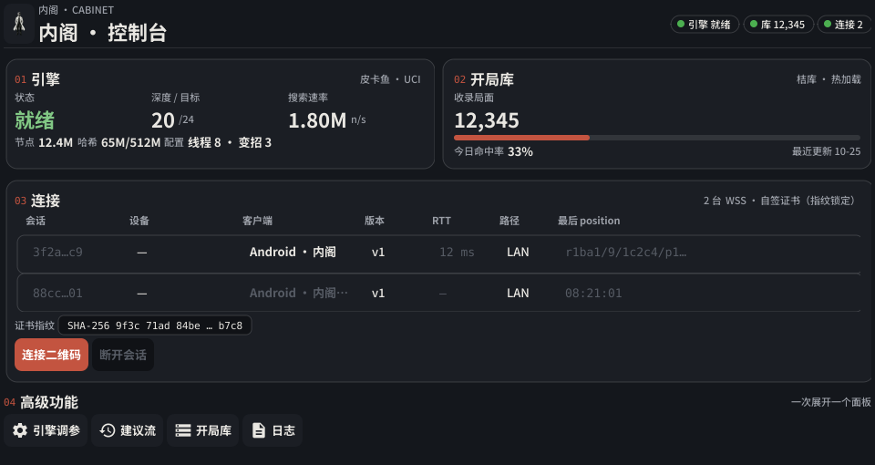
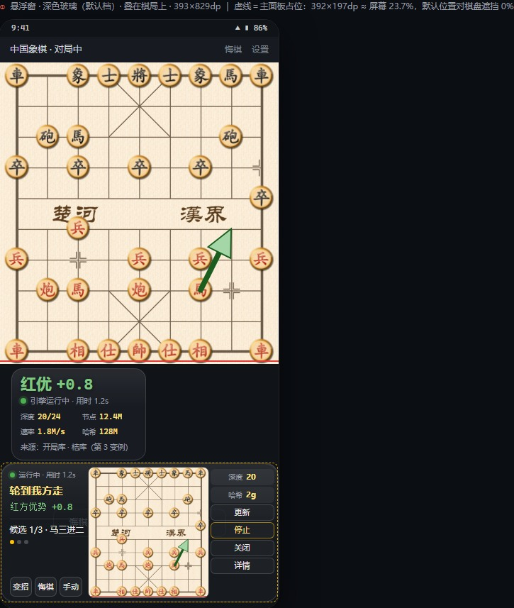

<p align="center"></p>

# 内阁（Cabinet）

<p align="center">
  <a href="https://github.com/Silva6c/cabinet/actions/workflows/go.yml"></a>
  <a href="https://github.com/Silva6c/cabinet/actions/workflows/release-build.yml"></a>
  <a href="https://github.com/Silva6c/cabinet/releases"></a>
  <a href="LICENSE"></a>
  
</p>

**手机做"眼睛"，电脑做"脑子"**——手机端通过录屏识别棋盘局面，电脑端用
皮卡鱼（Pikafish）引擎与开局库实时分析，建议以悬浮窗呈现在手机对局界面上。
适用于象棋 App 对局、复盘与学习场景。

> **合规声明**：本项目**只读屏幕、只做提示**——不自动走子、无点击注入、
> 无障碍服务或 Root 能力，仅使用 MediaProjection 录屏 + 悬浮窗展示。
> 请在对局允许辅助的场景使用，并对自己的账号行为负责。

## 功能特性

- **双端架构**：手机为瘦客户端（识别 + 悬浮窗），电脑承载引擎与开局库，
  经 WSS（自签证书 + 令牌 + 证书指纹锁定）通信；远程场景用 Tailscale 组网
  即可，无需公网 IP
- **三级建议**：开局库命中秒回 → 历史对局沉淀复用 → 引擎实时搜索，
  建议来源透明标注
- **双悬浮窗**：主窗（建议箭头 + 红黑胜率）+ 详情窗（深度/节点数/WDL/
  引擎状态），位置独立记忆
- **多路变招**：引擎 MultiPV 候选一键轮换查看
- **算力调节**：深度 / Hash / 线程数悬浮窗直调，不重启对局
- **扫码配对**：电脑端生成配对二维码，手机扫码即完成地址 / 令牌 / 指纹
  三项配置，令牌仅存哈希、可吊销

<p align="center">
  
  
</p>

## 系统要求

| 端 | 要求 |
|---|---|
| 电脑端 | Windows 10+ x64（皮卡鱼需要 AVX2 指令集）；从源码构建需 Go 1.26+ 与 MinGW-w64 |
| 手机端 | Android 8.0+；识别走 ONNX Runtime，YOLO 回退引擎可选 |
| 网络 | 手机与电脑同局域网（或同 Tailscale 网络），WSS 端口 9527 |

## 快速开始

### 1. 电脑端

```bash
# 构建（依赖 Go 1.26+ 与 MinGW-w64 gcc，见下文"从源码构建"）
scripts\build-exe.bat
# 或 make build（本机无 make 时用上面的脚本）
```

首次运行 `cabinet.exe` 会自动生成：

- `configs/cabinet.toml` —— 配置文件（含随机生成的配对令牌）
- `cert/server.crt|key` —— 自签证书（一经生成不要删除，否则全部手机需要重新配对）
- 托盘图标 —— 右键可打开控制台 / 日志目录 / 退出

**部署引擎与开局库**（受版权/条款限制，随源码分发不含这些文件，请自行获取）：

| 文件 | 放置位置 | 获取方式 |
|---|---|---|
| `pikafish.exe` | `library/engine/` | [official-pikafish releases](https://github.com/official-pikafish/Pikafish/releases)（按 CPU 选择构建） |
| `pikafish.nnue` | `library/nnue/` | 同上（注意其 [NNUE 附加条款](https://github.com/official-pikafish/Pikafish)，未经许可不得商用） |
| `*.obk` 开局库 | `library/books/` | 自备（推荐来源：[象棋鱼](https://github.com/zfdang/chinese-chess-fish-android)及其衍生库） |
| YOLO 模型 `yolov5n_xq_fp16.tflite` | 手机端 `assets/`（构建前放入） | 见 THIRD-PARTY-NOTICES §3 |
| ONNX 模型 `4_v6-0301.onnx` / `nano_v3-0319.onnx` | 手机端 `assets/models/`（构建前放入） | [yolo12138/Chinese_Chess_Recognition](https://huggingface.co/spaces/yolo12138/Chinese_Chess_Recognition)（MIT） |

放行防火墙：管理员运行 `scripts/allow-9527.bat`（或按提示手工放行 9527 端口）。

### 2. 手机端

```bash
cd phone
# 依赖 Android SDK（local.properties 或 ANDROID_HOME）
./gradlew :app:assembleArmv8DotprodRelease
# 产物：phone/app/build/outputs/apk/Armv8Dotprod/release/
```

1. 安装 APK，打开后进入连接页
2. 电脑端托盘 → 打开控制台 → 连接区 → 生成配对二维码
3. 手机端扫码完成配对（地址 + 令牌 + 证书指纹一次带入）
4. 授权悬浮窗与 MediaProjection 录屏权限
5. 打开象棋 App 进入对局，悬浮窗即自动工作

> Android 14+ 的 MediaProjection 授权为一次性：每次录屏会话结束需要重新授权，
> 这是系统行为，重新点亮悬浮窗即可。

## 故障排查（FAQ）

| 现象 | 处理 |
|---|---|
| 连接被拒绝 | 电脑端未启动，或 9527 端口未放行（运行 `scripts/allow-9527.bat`） |
| 连接超时 | IP 不可达：检查手机与电脑是否同一网段 / 同一 Tailscale 网络 |
| 证书指纹不匹配 | 电脑端证书被重建过——重新扫码配对即可（`cert/` 不要手动删除） |
| 悬浮窗不出现 | 系统设置里授予"显示在应用上层"权限 |
| 建议迟迟不出 | 确认 `library/` 引擎与开局库已就位；引擎状态见悬浮窗详情页 |
| 模拟器联调 | 模拟器内地址填 `wss://10.0.2.2:9527/ws`（宿主回环） |

## 从源码构建（开发）

**电脑端**（Windows）：

1. 安装 [Go 1.26+](https://go.dev/dl/) 与 [MinGW-w64](https://winlibs.com/)
   （解压后将 `bin` 目录加入 PATH，或按 `scripts/build-exe.bat` 内的探测逻辑放置）
2. `go build` 需要 CGO（Fyne 图形栈）；国内网络可设置
   `GOPROXY=https://goproxy.cn,direct`
3. 常用命令：`make build` / `make test` / `make lint`
   （提交前请保证 `golangci-lint run` 零告警）

**手机端**：Android Studio 打开 `phone/`，或命令行
`./gradlew :app:assembleArmv8DotprodRelease`；单元测试
`./gradlew :app:testArmv8DotprodDebugUnitTest`。

**控制台调试版**（无托盘）：`go build -tags console -o cabinet-console.exe ./cmd/cabinet`

## 文档

| 文档 | 内容 |
|---|---|
| [系统技术文档](docs/technical-overview.md) | 双端架构、模块详解、安全模型、部署运维 |
| [协议 v1](docs/protocol-v1.md) | WSS 通信协议定稿（帧结构 / 握手 / 全部消息类型） |
| [手机端 WDL 接入指南](docs/phone-wdl-guide.md) | 胜率和引擎指标字段的协议增量 |

## 许可与致谢

本项目以 **GPL-3.0** 授权发布（见 [LICENSE](LICENSE)）。这同时是本项目所引用
的 GPL 组件（皮卡鱼、DroidFish、VinXiangQi 等）的合规要求——对外分发 APK 或
便携包时需以同许可证提供对应源码。

致谢（完整清单与各组件许可见
[THIRD-PARTY-NOTICES.md](THIRD-PARTY-NOTICES.md)）：

- [Pikafish](https://github.com/official-pikafish/Pikafish)（GPL-3.0）——分析引擎
- [DroidFish](https://github.com/peterosterlund2/droidfish)（GPL-3.0）——棋规引擎基础
- [VinXiangQi](https://github.com/Vincentzyx/VinXiangQi)（GPL-3.0）——YOLO 识别回退引擎
- [yolo12138/Chinese_Chess_Recognition](https://huggingface.co/spaces/yolo12138/Chinese_Chess_Recognition)（MIT）——识别模型权重
- [象棋鱼 zfdang/chinese-chess-fish-android](https://github.com/zfdang/chinese-chess-fish-android)（MIT）——开局库数据来源
- 象棋迪克与 [zfdang/chinese-chess-android](https://github.com/zfdang/chinese-chess-android)（GPL-3.0）——棋盘位图与棋规参考
- [Fyne](https://github.com/fyne-io/fyne)、[OkHttp](https://github.com/square/okhttp)、
  [onnxruntime](https://github.com/microsoft/onnxruntime) 等开源依赖
