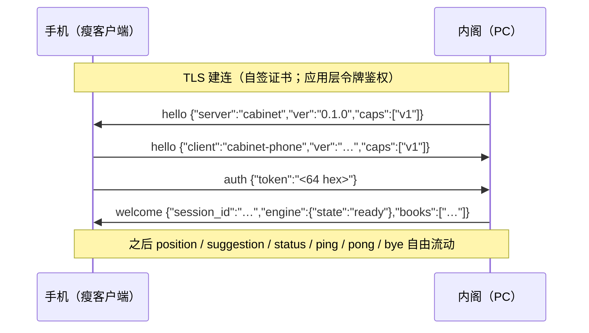

# 内阁协议 v1（定稿）

> 状态：**v1 定稿**。M2 手机端实现时照抄本文档，字段名不再变更。
> 变更规则：只加不改（新增字段/消息走 caps 协商）；破坏性变更升 v2。

## 1. 传输层

- 路径：局域网 `wss://<电脑IP>:9527/ws`（远程接入用 Tailscale 等 VPN 组网后仍走局域网地址，协议不变，不做独立中继）。
- 证书：PC 端自签（**证书一经生成永不自动重建**——手机端固定证书指纹，重建 = 全部手机断联）。
  客户端证书指纹锁定：手机端配置"证书指纹"（SHA-256，64 位 hex，容忍大写与冒号分隔）后，
  握手时校验服务器链首证书 SHA-256 摘要，不匹配即断开；指纹为空 = 不校验（联调模式）。
  指纹经配对二维码 `cabinet://connect?...&f=<指纹>` 带外传递（PC 控制台"②连接"区也可见可复制）。
- 鉴权：应用层令牌（64 字符 hex），不使用 TLS 客户端证书。
- 帧：**WebSocket 文本帧**，一帧一条 JSON，UTF-8，禁止分片逻辑帧。
- 单帧上限：64 KB（服务器强制，超出即断开）。

## 2. 帧结构

所有帧共用外层结构，字段顺序不敏感，但 `v`、`t` 必须在最外层：

```json
{"v":1,"t":"<type>", ...}
```

| 字段 | 类型 | 说明 |
|---|---|---|
| `v` | int | 协议版本，当前恒为 `1`。缺失或 `≠1` → 回 `error{code:"unsupported_version"}` 并断开 |
| `t` | string | 消息类型，见 §4。缺失或未知 → 未知类型**静默忽略**（记日志）；缺 `t` → `error{code:"bad_frame"}` |

其余字段按类型定义（§4）。收到本端不该发的帧（如手机发 `suggestion`）一律忽略并记日志。

## 3. 握手时序（钉死，不可变更）

**连接建立后 PC 先发 `hello`**，随后手机回 hello、发 auth，PC 回 welcome：



- **鉴权窗口：连接建立后 10 秒内必须完成整个握手**（含收发 hello 与 auth），超时 PC 回 `error{code:"auth_required"}` 并断开。
- 握手完成前收到 hello/auth 以外的帧：回 `error{code:"auth_required"}`，继续等待（不立即踢，由 10s 窗口兜底）。
- 令牌错误：回 `error{code:"auth_failed"}` 并立即断开。
- 重复 `hello`：后到覆盖先到；重复 `auth`：忽略。
- `welcome` 后进入会话，`session_id` 为本次连接唯一标识（16 hex 字符），仅用于日志关联。

## 4. 消息定义（字段名逐字定死）

### 4.1 hello（双向）

PC 端 `server` 字段恒为 `"cabinet"`；手机端 `client` 字段约定为 `"cabinet-phone"`。二者互斥，同一帧只出现其一。

| 字段 | 类型 | 必填 | 说明 |
|---|---|---|---|
| `v` | int | 是 | 恒 `1` |
| `t` | string | 是 | `"hello"` |
| `client` | string | 二选一 | 手机端标识，**固定字符串 `"cabinet-phone"`** |
| `server` | string | 二选一 | PC 端标识，**固定字符串 `"cabinet"`** |
| `ver` | string | 是 | 本端软件版本（semver 字符串，如 `"0.1.0"`） |
| `caps` | string[] | 是 | 能力列表，v1 恒 `["v1"]`；未来新增能力追加字符串 |

```json
{"v":1,"t":"hello","server":"cabinet","ver":"0.1.0","caps":["v1"]}
{"v":1,"t":"hello","client":"cabinet-phone","ver":"0.1.0","caps":["v1"]}
```

### 4.2 auth（手机→PC）

| 字段 | 类型 | 必填 | 说明 |
|---|---|---|---|
| `v` / `t` | | 是 | `1` / `"auth"` |
| `token` | string | 是 | 配对令牌（64 字符 hex）；服务器只存哈希（M1 起配对流程） |

```json
{"v":1,"t":"auth","token":"a1b2c3…"}
```

### 4.3 welcome（PC→手机，auth 成功后）

| 字段 | 类型 | 必填 | 说明 |
|---|---|---|---|
| `v` / `t` | | 是 | `1` / `"welcome"` |
| `session_id` | string | 是 | 本次会话标识（16 hex 字符） |
| `engine` | object | 是 | `{"state":"offline\|loading\|ready\|error"}`；另带 `depth`/`hash_mb`（可选，2026-10-02 起）：PC 引擎实际算力值（引擎桥可用时填写），手机端算力按钮的显示与循环起点以此为準，避免与 PC 脱节（此前手机只能显示本地默认档，出现"手机 0.25g / 电脑 2048"的错位） |
| `books` | string[] | 是 | 已启用的开局库名（来自 PC 端当前加载的桔库列表；未配置库时为空数组） |

```json
{"v":1,"t":"welcome","session_id":"f3a9c2e81b7d4066","engine":{"state":"ready","depth":20,"hash_mb":2048},"books":[]}
```

### 4.4 position（手机→PC）

| 字段 | 类型 | 必填 | 说明 |
|---|---|---|---|
| `v` / `t` | | 是 | `1` / `"position"` |
| `fen` | string | 是 | xqbase 风格 FEN（6 段），行棋方 `w`=红、`b`=黑。例：`rnbakabnr/9/1c5c1/p1p1p1p1p/9/9/P1P1P1P1P/1C5C1/9/RNBAKABNR w - - 0 1`。**FEN 与着法坐标沿用本仓 `gamelogic` Board/Move 的 UCCI 约定（源自 DroidFish/象棋迪克系谱，见 THIRD-PARTY-NOTICES）：列 `a`–`i` 为红方视角从左到右，行号 1–9 从红方底线数起（即 `Move.getUCCIString()` 的 `'a'+x, 9-y` 映射）；FEN 棋盘行序自上而下（黑方底线在前）** |
| `red_go` | bool | 是 | 红方行棋为 `true`（与 `fen` 第 2 段一致，冗余字段便于对端直读） |
| `history` | string[] | 否 | 本局至今的 UCCI 着法序列（4 字符坐标格式，如 `"h2e2"`），按时间序；**M0/M1 服务端只透传不校验**；M2 起由手机端对比前后确认局面自动生成；缺省 `[]` |
| `force` | bool | 否 | 强制重新分析（手机端"更新"按钮置位）：`true` 时 PC **跳过桔库与沉淀缓存**直接进引擎重搜。缺省 `false` 走常规"桔库→沉淀→引擎"路径。场景：同一局面重发（如用户点"更新"）会被桔库命中短路回单条库建议，刚在电脑端调好的多路变招（MultiPV 各线）候选拿不回来；`force` 保证新算力参数立刻体现。旧 PC 端把 `force` 当未知字段忽略（§7），行为同缺省 |
| `new_game` | bool | 否 | 新局标记（2026-10-17）：手机端识别到开局阵型确认（NEW_GAME，含 (9,7) 红马错位容错）后**的首条 position** 置位，仅出现一次。PC 端据此生成新 `game_id` 给建议沉淀打局归属标记（对局边界信号，供将来按局统计；PC 端"按局复盘"下拉已于 2026-10-18 移除，打标链保留）。缺省/旧 PC 忽略（§7），功能无损。**重发/补发不带此标记**（防拆局） |

```json
{"v":1,"t":"position","fen":"rnbakabnr/9/1c5c1/p1p1p1p1p/9/9/P1P1P1P1P/1C5C1/9/RNBAKABNR w - - 0 1","red_go":true,"history":[]}
{"v":1,"t":"position","fen":"rnbakabnr/9/1c5c1/p1p1p1p1p/9/9/P1P1P1P1P/1C5C1/9/RNBAKABNR b - - 0 1","red_go":false,"force":true}
```

幂等语义：服务器对每会话只保留**最新一条** position；重连后客户端必须重发最近 position；新 position 到达时进行中的查询被打断（打断细节 M1 引擎桥实现）。

### 4.5 suggestion（PC→手机）

| 字段 | 类型 | 必填 | 说明 |
|---|---|---|---|
| `v` / `t` | | 是 | `1` / `"suggestion"` |
| `source` | string | 是 | `"book:<库名>"` 或 `"engine"` |
| `fen` | string | 否 | 本建议对应的局面 FEN（2026-10-02 起 PC 端填写）：手机端据此丢弃迟到旧建议——旧建议对着新棋盘渲染会误报"轮次可能识别有误"并压掉箭头 |
| `bestmove` | string | 是 | UCCI 4 字符着法（如 `"h2e2"`）；无着可走时为 `"null"` |
| `score` | object | 否 | **红方统一视角**：`{"cp":<int>}` 厘兵分，正=红方优；或 `{"mate":<int>}` N 步将杀，正=红方将杀黑方、负=黑方将杀红方。引擎原生的走子方视角分数由 **PC 端换算**后再下发，PC 沉淀时另存原生分。二者只出现其一 |
| `pv` | string[] | 否 | 主要变着（UCCI 4 字符序列），库命中可缺省 |
| `depth` | int | 否 | 引擎搜索深度（库命中可缺省） |
| `wdl_w` / `wdl_d` / `wdl_l` | int | 否 | 胜/和/负概率（红方视角百分比；引擎 `UCI_ShowWDL` 输出经 PC 换算）。可选字段，引擎未输出时缺省；旧端忽略（协议 §7） |
| `multipv` | int | 否 | 线/候选序号（1=最优线）。**三种下发场景**：①引擎 MultiPV>1 逐线下发；②终值帧恒 1；③**桔库候选唤醒（2026-10-17）**：桔库命中时把库内多候选（≤5 条，按 vscore 降序）逐条下发，各带序号 1..N（实测真实桔库仅 0.81% 局面有 ≥2 候选，单候选局面与旧行为等价）。PC 端 MultiPV=1 或沉淀命中时缺省。手机端按"每个序号一个槽位"聚合：同序号新着法覆盖旧着法，候选总数恒等于 PC 本轮已报出的线数 |
| `cached` | bool | 否 | 沉淀库缓存命中标记（2026-10-17）：`true` 表示本建议来自沉淀库（同局面历史引擎终值直接回放，未进引擎现算），悬浮窗据此显示"缓存"弱标记。仅沉淀命中时出现（`omitempty`：引擎/桔库路径整字段省略）；旧端忽略（§7）。注意与 `source` 独立判断——沉淀记录的 `source` 可能沿用原记录的 `"book:<名>"`，不能靠来源前缀判缓存 |

```json
{"v":1,"t":"suggestion","source":"engine","bestmove":"h2e2","score":{"cp":120},"pv":["h2e2","b9c7","h0g2"],"depth":20,"wdl_w":62,"wdl_d":31,"wdl_l":7,"multipv":1}
{"v":1,"t":"suggestion","source":"book:桔库09.09.2023精修库","bestmove":"b2e2"}
```

**推送时机（定稿）**：引擎搜索期间，**每次 depth 提升、或 bestmove 发生变化即推送一条** `suggestion`（MultiPV>1 时各线独立推送，`multipv` 标明线序号；终值帧只含第一线，`multipv` 恒 1）；搜索结束（收到 bestmove）再推一条终值。库命中推一条；**桔库多候选局面逐候选推一条**（各带 `multipv` 序号，2026-10-17 起桔库候选唤醒）。同局面重复推送允许，客户端以最新一条为准。

**路由（定稿）**：`suggestion` 与具体局面绑定，**仅下发给提交该局面的连接**（最近一次有效 `position` 的会话）；该连接已断开则丢弃，不广播。`status` 是引擎全局状态，保持广播给全部连接。多设备同时连接时各收各的建议，互不串台（引擎同一时刻只服务最近提交的局面，即"最新覆盖"）。

### 4.6 status（PC→手机）

| 字段 | 类型 | 必填 | 说明 |
|---|---|---|---|
| `v` / `t` | | 是 | `1` / `"status"` |
| `engine` | object | 是 | `{"state":"…","depth":<int>,"nodes":<int>,"nps":<int>,"hashfull":<int>}`；`state` 同 §4.3；depth/nodes/nps/hashfull 引擎搜索中才有，hashfull 为千分比 0–1000 |
| `rtt_ms` | int | 否 | 最近一次心跳往返毫秒数 |

```json
{"v":1,"t":"status","engine":{"state":"ready","depth":12,"nodes":123456,"nps":500000,"hashfull":30},"rtt_ms":12}
```

M0 骨架行为：收到 `position` 后回 `status{"engine":{"state":"offline"}}`（仅确认链路，不含搜索指标）。

**推送节奏（定稿）**：引擎搜索期间，**每 500 ms 或 depth 变化时推送一条** `status`（带实时 depth/nodes/nps/hashfull）；**引擎状态（state）发生任何变化时立即推送**（如 loading→ready、ready→error）。非搜索期不周期推送。

**搜索收束（定稿）**：本轮搜索结束（bestmove 终值 suggestion 下发后），服务器广播一条**仅含 `state` 的 status**（`{"v":1,"t":"status","engine":{"state":"ready"}}`，depth/nodes/nps/hashfull 字段缺省——指标字段仅搜索中才有值），客户端以此帧作为本轮建议收束的信号。

### 4.7 ping / pong（双向心跳）

| 字段 | 类型 | 必填 | 说明 |
|---|---|---|---|
| `v` / `t` | | 是 | `1` / `"ping"` 或 `"pong"` |
| `ts` | int | 是 | 发送方 Unix 毫秒时间戳；**pong 必须原样回传收到的 `ts`**，发送方用 `now - ts` 算 RTT |

约定：客户端每 15–30 秒发一次 `ping`；双方收到 `ping` 必须立即回 `pong`。**PC 侧每 15 秒主动发一次 `ping` 测量 RTT**（控制台连接区显示），客户端必须以原 `ts` 回 `pong`。**PC 侧死链检测：服务器 45 秒（3 个心跳周期）未收到该连接的任何帧即判定死链，主动断开**；客户端侧由重连逻辑兜底。

```json
{"v":1,"t":"ping","ts":1757459200123}
{"v":1,"t":"pong","ts":1757459200123}
```

### 4.8 error（双向）

| 字段 | 类型 | 必填 | 说明 |
|---|---|---|---|
| `v` / `t` | | 是 | `1` / `"error"` |
| `code` | string | 是 | 见 §5 错误码 |
| `message` | string | 是 | 面向人的中文描述 |
| `fen` | string | 否 | 触发本错误的局面回显（2026-10-02 起，bad_frame/bad_position 携带）：手机端只处理与当前局面一致的错误，迟到旧错误只记日志——否则会对新局面错翻轮次或误挂"识别异常" |
| `turn_flip_legal` | bool | 否 | 仅 `bad_position`：`true` 表示把走子方 w/b 翻转后该局面即通过引擎安全校验（被将军方必须行棋是唯一自洽解释）——手机端据此自动纠正走子方并 force 重发，无需用户点"更新"；`false` 时盘面本身有错（遮挡漏识别等），手机端做一次全屏重定位自愈，二次仍拒才提示 |

```json
{"v":1,"t":"error","code":"auth_failed","message":"配对令牌不正确"}
{"v":1,"t":"error","code":"bad_position","message":"局面识别异常（…）","fen":"3akR3/… w - - 0 1","turn_flip_legal":true}
```

### 4.9 bye（双向）

优雅断开。收到 `bye` 后回一条 `bye` 再关闭连接（单次，不递归回应对方的 bye 回执）。

PC 侧允许主动 `bye` 断开任一会话（控制台"② 连接"区选行 → 断开会话，管理操作）：
先发 `bye` 再关闭连接；手机端按断线处理（自动退避重连，令牌有效即可重连成功，
不构成封禁）。未完成握手的连接同样可被手动断开。

```json
{"v":1,"t":"bye"}
```

### 4.10 set_engine（手机→PC，M3 起远程调节引擎算力）

手机端 / 桌面面板调整电脑端皮卡鱼算力（深度 / Hash / 线程数 / MultiPV）。全部字段可选，只传要改的字段；PC 端逐字段校验并应用，任一字段超出范围则整帧拒绝（回 `error{code:"bad_frame"}`，不部分应用）。应用成功后，若引擎就绪且最近有局面，PC 立即以最近局面重新搜索，让新算力立刻生效；搜索结果按既有 suggestion/status 节奏下发，无需额外确认帧。

| 字段 | 类型 | 必填 | 说明 |
|---|---|---|---|
| `v` / `t` | | 是 | `1` / `"set_engine"` |
| `depth` | int | 否 | 固定深度制搜索目标，范围 1–40 |
| `hash_mb` | int | 否 | 置换表大小（MB），`0`=自动（2GiB），或 32–32768 |
| `threads` | int | 否 | 引擎线程数，`0`=自动（逻辑处理器数的一半），或 1–64 |
| `multi_pv` | int | 否 | 多 PV 线数，范围 1–5（>1 时算力分摊给候选着法，1=最强但无变招候选） |

字段以**是否出现**区分"未传"与零值（`threads:0`、`hash_mb:0` 是合法的"切自动档"，与省略字段含义不同）。新增字段对旧客户端向后兼容（协议 §7：旧端忽略未知字段，无需升版本）。

```json
{"v":1,"t":"set_engine","depth":18,"hash_mb":512}
{"v":1,"t":"set_engine","threads":0,"multi_pv":1}
```

生效时机：threads / hash_mb / multi_pv 变更在**下一次搜索开始前**按 Threads→Hash→MultiPV 顺序应用（UCI 规范要求 setoption 在空闲期发送，官方要求 Threads 先于 Hash 设置）；深度即时生效于下一次 `go depth`。未连接手机时该帧不会出现。

suggestion 帧（§4.5）同步新增可选字段 `wdl_w` / `wdl_d` / `wdl_l`：胜/和/负概率（红方视角百分比，引擎 `UCI_ShowWDL` 输出换算），引擎未输出时缺省，旧端自动忽略。

### 4.11 log（手机→PC，真机诊断日志上行）

手机端把应用内诊断日志（识别/建议/连接状态机）批量上行，PC 端按接收顺序**原样落盘**（行前缀 PC 接收时刻与短会话 ID），供真机问题排查——无需 USB 连线抓 logcat。纯诊断辅助：PC 端写失败只记调试日志，不影响对局链路；`lines` 为空数组时忽略。

**单局分卷（定稿）**：手机端识别到新对局（开局阵型确认）时在上行流中插入分界行 `HH:mm:ss.SSS I/<tag>: ===== 新局开始 fen=<fen> =====`；PC 端检测到该行即切换下一局日志文件 `phone-<局开始时刻>-局<N>.log`（如 `phone-20261001-094412-局3.log`），一局一文件便于按局检索（2026-10-01 用户反馈：单日单文件混多局检索困难）。序号为 PC 进程内递增，PC 重启后重计——文件名含开始时刻，跨重启不冲突。PC 端切局时顺带清理 7 天前的手机日志文件。

| 字段 | 类型 | 必填 | 说明 |
|---|---|---|---|
| `v` / `t` | | 是 | `1` / `"log"` |
| `lines` | string[] | 是 | 手机端预格式化日志行（`HH:mm:ss.SSS L/tag: 消息`，L∈V/D/I/W/E），一批 ≤ 数百行 |

手机端以约 2s 周期批量发送，且仅连接就绪时发送；断连期间日志留在端上环形队列（约 400 行上限，满则丢最旧），重连后随下一批补上。旧 PC 端收到未知类型帧按协议 §2 静默忽略，向后兼容。

```json
{"v":1,"t":"log","lines":["08:53:46.926 I/AssistService: board confirmed: rnbakabnr/... w - - 0 1","08:53:46.928 I/RemoteAnalysis: position sent: rnbakabnr/..."]}
```

## 5. 错误码（枚举定死）

| code | 含义 | 是否断开 |
|---|---|---|
| `bad_json` | 帧不是合法 JSON | 否（记日志，继续） |
| `bad_frame` | JSON 合法但结构不合格（缺 `t`、必填字段缺失/类型错） | 否 |
| `bad_position` | 局面无法安全送引擎（走子方能一步吃到对方将/帅、缺将帅等）。错误帧带 `fen` 回显与 `turn_flip_legal` 标记（§4.8），手机端自动纠正/自愈 | 否（提示手机端重新识别） |
| `unsupported_version` | `v` 缺失或 `≠1` | **是** |
| `auth_required` | 未完成鉴权就发业务帧 / 握手超时 | 超时**是**，其余否 |
| `auth_failed` | 令牌错误 | **是** |
| `not_ready` | 服务未就绪（如引擎未起，M1 起用于 position 前置校验） | 否 |
| `rate_limited` | 发送频率超限（M1 起实施） | 否 |
| `internal` | 服务器内部错误 | 否 |

## 6. 重连语义

- 客户端指数退避重连：基准 1s，倍增，上限 5s，无抖动（局域网直连重试成本低，封顶保证 PC 恢复后快速跟上；与手机端 `RemoteAnalysisClient` 实现一致）。
- 重连成功（收到 `welcome`）后**必须重发最近一条 position**；服务器"最新覆盖"幂等，无副作用。
- **not_ready 恢复（定稿）**：客户端因 `error{code:"not_ready"}`（引擎未就绪）被拒后，**收到 `status{engine:{state:"ready"}}` 时重发最近一条 position**，无需等待用户操作。
- 服务器重启期间客户端持续退避重试，不做本地引擎回退。

## 7. 版本化与扩展

- 未知 `t` 静默忽略（记 debug 日志）+ `caps` 协商 → 双方可独立升级。
- 新增字段：旧端忽略未知字段（JSON 反序列化宽容语义），不报错。
- 破坏性变更：升 `v` 为 2，旧端收到 `unsupported_version` 后提示升级。
- **历次字段登记**（新字段均按本节语义加，不升版本）：2026-10-02 `suggestion.fen`（迟到旧建议过滤）；2026-10-03 `suggestion.wdl_w/wdl_d/wdl_l`（胜率和负概率）；**2026-10-17 `position.new_game`（新局标记→PC 生成对局 ID）+ `suggestion.cached`（沉淀命中标记）+ `suggestion.multipv` 语义扩展（桔库多候选也带序号，新增帧不改字段结构）**。PC 端 `internal/server/protocol_bench_test.go` 的逐字节 golden 锚锁死既有字段编码形态——加字段必须保持 omitempty 且不动既有字段顺序，否则锚变红即协议破坏。

## 8. M0 联调

M0 骨架的服务器行为（echo 基准）：`position` → `status{engine:{state:"offline"}}`；`ping` → `pong`；`bye` → `bye`。引擎/开局库相关字段均为占位。

模拟手机端（两种等价，任选）：

```bash
# Go 版（推荐，无外部依赖）
go run ./tools/mockphone -url wss://127.0.0.1:9527/ws -token <令牌>

# Node 版（Node ≥ 22，用全局 WebSocket；自签证书需用环境变量关闭校验，
# 不要把关闭校验写死进任何脚本）：
#   Git Bash:    NODE_TLS_REJECT_UNAUTHORIZED=0 node tools/mock-phone.mjs wss://127.0.0.1:9527/ws <令牌>
#   PowerShell:  $env:NODE_TLS_REJECT_UNAUTHORIZED="0"; node tools/mock-phone.mjs wss://127.0.0.1:9527/ws <令牌>
```

wscat 亦可（若已安装）：`wscat --no-check -c wss://127.0.0.1:9527/ws`，随后手工粘贴各帧 JSON。
