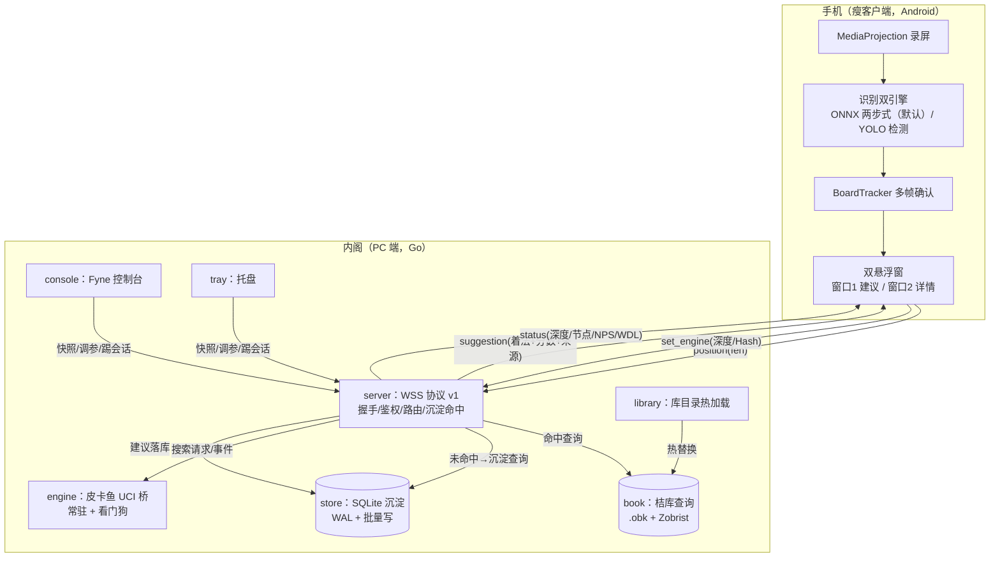
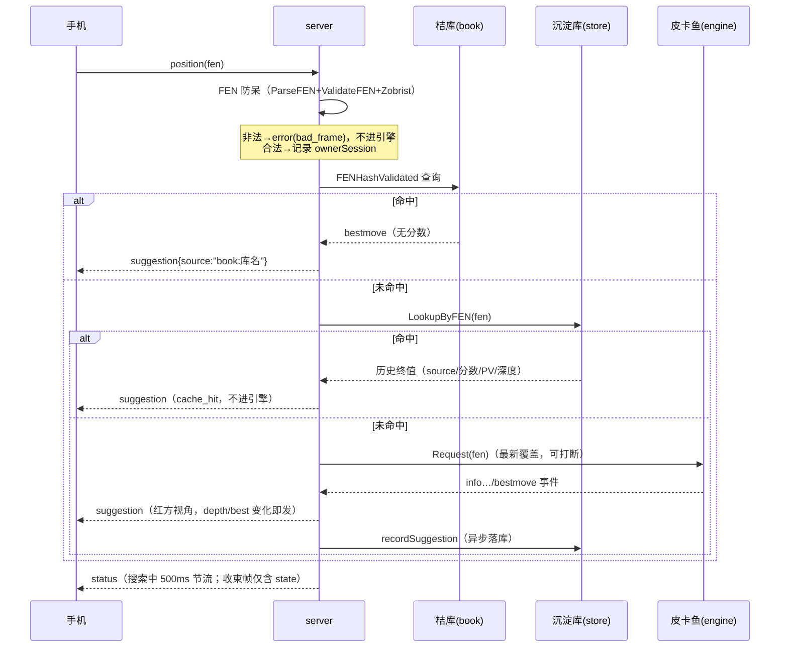
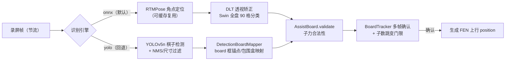

# 内阁（Cabinet）系统技术文档

> 面向开发与运维的实现现状文档。线上协议以《[protocol-v1.md](protocol-v1.md)》为准；
> 手机端 WDL 显示见《[phone-wdl-guide.md](phone-wdl-guide.md)》。
> 合规红线（不可妥协）：任何代码不得含自动走子、点击注入、无障碍服务、Root 能力。

## 1. 系统概述

手机做"眼睛"（MediaProjection 录屏 + 本地识别 + 双悬浮窗提示），电脑做"脑子"
（皮卡鱼引擎 + 桔库开局库 + SQLite 沉淀）。两端经 WSS（协议 v1）通信：局域网直连
（自签证书 + 令牌 + 证书指纹锁定），远程场景用 Tailscale 组网后仍连局域网地址（无自研中继）。



一次建议的路径：局面稳定确认 → position 上行 → PC 三级查找（桔库 → 沉淀库 → 皮卡鱼）
→ suggestion 下发（红方视角分数）→ 悬浮窗绿箭头。库命中秒回；引擎路径按目标深度
（默认 20）数秒内出解。

## 2. 仓库与运行时布局

```
cabinet/
├─ cmd/cabinet/          # 入口：装配/单实例锁/优雅关闭（-no-tray、-gen-token）
├─ internal/
│  ├─ server/            # WSS 协议 v1：编解码/握手/路由/沉淀命中/快照/手动断开
│  ├─ engine/            # 皮卡鱼 UCI 桥：常驻进程/看门狗退避/最新覆盖/运行中调参
│  ├─ book/              # 桔库 Go 移植：Zobrist 查询键 + FEN 解析校验 + 只读查询
│  ├─ library/           # books/ 目录热加载（fsnotify 防抖 + zip 自动解压）
│  ├─ store/             # SQLite 沉淀：异步批量写 / FEN 查询 / 90 天裁剪
│  ├─ console/           # Fyne 主控制台（基础区 + 折叠高级面板）
│  ├─ tray/              # Windows 托盘
│  ├─ update/            # 自更新：检查/确认式下载安装/换入回滚（开源后生效）
│  ├─ config/            # TOML 配置（默认值生成/回填/持久化）
│  └─ logging/           # slog + lumberjack 滚动日志
├─ phone/                # Android 瘦客户端（Gradle 工程，见 §6）
├─ docs/                 # 协议/指南/本技术文档
├─ tools/                # mockphone（Go）/ mock-phone.mjs / mock-idle.mjs /
│                        #   gen-zobrist-table.py / icon_gen.py / vector-gen（Java 向量生成）
├─ scripts/allow-9527.bat  # 防火墙放行（管理员运行，幂等）
├─ testdata/             # 桔库 1234 条 Java/Go 双端比对向量
└─ reference/            # 上游参考拷贝（只读，GPL；本地部署位，不随仓库分发）
```

运行时产物（均 gitignore，不进版本库）：

| 路径 | 内容 | 说明 |
|---|---|---|
| `configs/cabinet.toml` | 实际配置（含令牌） | 首次启动自动生成默认配置 |
| `cert/server.crt|.key` | 自签证书（ECDSA P-256，10 年） | **铁律：绝不自动重建**，重建 = 全部手机需重新配对 |
| `logs/cabinet.log` | 滚动日志（10MB×5，压缩） | windowsgui 构建只写文件；console 构建双写 stdout |
| `data/suggestions.db` | 沉淀库（WAL，附 -wal/-shm） | 90 天自动裁剪 |
| `library/books/*.obk` | 桔库 | `.obk.zip` 落地自动解压、增删热加载 |
| `library/engine/pikafish.exe` | 皮卡鱼 2026-09-06 | 缺失时服务退化无引擎模式（回 not_ready） |
| `library/nnue/pikafish.nnue` | NNUE 权重 | 版权物，另行分发 |
| `assets/icon/` | 托盘/窗口图标 | 磁盘优先于内嵌资源（可覆盖不发版） |

版权物隔离：桔库 `.obk*`、`*.nnue`、手机端 `*.tflite`/`*.onnx`、皮卡鱼发布包均不进 git，
由部署者自行放置；`reference/`（GPL 拷贝）只读参考、不进编译。

## 3. PC 端模块详解（Go 1.26）

依赖：fyne/v2 2.8.1、fyne.io/systray、BurntSushi/toml、fsnotify、gorilla/websocket、
skip2/go-qrcode、lumberjack、modernc.org/sqlite（纯 Go）、golang.org/x/sys。

### 3.1 cmd/cabinet —— 装配与生命周期

- 组装顺序：配置 → 令牌（空则生成回写）→ 证书（EnsureCert）→ 指纹 → 引擎桥 → 沉淀库 →
  库管理 → WSS 服务（后台 goroutine）→ 托盘（`LockOSThread` 独立 goroutine，win32 消息循环
  同线程约束）→ Fyne 控制台（占主 goroutine，GLF 约束）。
- 单实例锁：命名互斥体 `Local\cabinet-singleton`，双开时 MessageBox 提示看托盘
  （`-no-tray` 模式静默退出）；互斥体创建失败放行（端口占用兜底）。
- 优雅关闭：ctx 取消 → 服务 Shutdown 最多 6s → 引擎退出最多 8s（超时告警可能残留
  pikafish.exe）；托盘/控制台退出互为联动（均幂等）。
- flag：`-config`（默认 `configs/cabinet.toml`）、`-gen-token`、`-no-tray`（构建标签
  `console` 时默认 true）。

### 3.2 internal/server —— 协议服务端

**协议层**：12 种帧（hello/auth/welcome/position/suggestion/status/ping/pong/error/bye/
set_engine/log）；单帧上限 64KiB（超出即断开）；`frameBase{v,t}` 嵌入保证 v/t 序列化在前
（有测试固化）；错误码 10 种（`rate_limited` 已定义未使用）。令牌校验
`subtle.ConstantTimeCompare` 恒时比较，防时序侧信道。

**连接与会话**：会话 ID 16 hex；写全经 `Conn.writeMu` 串行（gorilla 禁止并发写）；
连接表 `Hub`（map+Mutex）。`Welcome.books` 回填当前已启用库名（第二轮审查 P1-3 起）。

**握手**（协议 §3 钉死）：PC 先发 hello → 手机 hello+auth → 10s 窗口 → welcome（携带
session_id 与引擎状态）。鉴权失败回 `auth_failed` 后断开（手机端据此停止重连）；窗口内
业务帧提示不踢。

**心跳与死链**：PC 每 15s 主动 ping 测 RTT（控制台显示）；每帧后重置读超时，
**45s 无任何帧判定死链**（= 3 个心跳周期）。手机端另有 20s 自发 ping 保活 NAT。

**position 处理（三级查找，server.go handlePosition）**：



- **建议路由**：suggestion 只发给提交该局面的连接（`ownerSession` → `Hub.SendToSession`），
  归属断开则丢弃——多设备各下各的棋，宁可不发不可错发；status 保持广播（引擎是全局状态）。
  **全链留痕**（2026-11-15 实战七问观测补齐）：引擎请求提交（fen/是否带历史/pv_once）、
  建议下发（来源/着法/局面/深度/线号）、搜索被打断、结果被最新覆盖丢弃、not_ready
  五处此前零日志的节点补齐 INFO/Warn——11-14 16:05"无指导 77.5s"窗口无法定案的
  直接原因是观测黑洞。
- **三次重复防御三件套**（2026-11-15 实战七问定稿；此前引擎/云库/残局路径零规避，
  均势残局直搜/复播循环直到判和——15:56/16:08/11-15 15:34 三次实锤）：
  ①**判和记忆独立**（history.go）：occ 出现序列与 fens/moves 搜索链解耦——两步合并/
  识别抖动/悔棋的链重置不再清空"该局面已出现过几次"的记忆；读取侧分工：库/沉淀/云/
  终值四路的三次重复预演（moveCausesTripleRep）读 occ，是否给引擎带历史
  （hasRepetitionRisk）保持读链（occ 判出重复而链已重置时带历史=喂假历史，超避让
  复发）；起始阵型兜底清 occ（旧端无 NEW_GAME 标记的换局，防跨局污染）。
  ②**引擎终值规避**（enginePump repAvoid 状态机）：终值着法将判和时带 `rep_risk`
  警示照发（不丢帧）+ 替代重搜**惰性触发**（2026-11-17 用户拍板，A/B 体感"变脸
  打扰"根治）：先只挂起 2.5s 停留窗口（快节奏落子 <2.5s 即作废——零打扰零清
  TT），到点经 fen/gen/lastFen 三重校验才发起一次性 4 线重搜（复用 pvOnce 通路：
  清 TT + smart 豁免，此时引擎必然空闲）；收束后**追加式下发**（红队吸收）——
  按引擎线序原 rank 下发，主选永不重排变脸，rank1 仍判和则补 `rep_risk`，非重复
  线自然落候选 2/N"安静出现"（原"首个非重复线提主选"恰把变脸打在用户停留观看
  时刻）；主选仍判和时跳过沉淀（与普通终值判和分支同口径防复播污染）；全部线
  伪非法退普通路径（每局面只规避一次防重搜风暴）；状态绑定局面+代次，结果过期
  丢弃/局面切换/引擎重启/挂起期走子全路径清障。
  ③**云库/残局警示照发**（cloudbook.go）：命中着法将判和时带 `rep_risk` 照发不丢弃
  ——cloud_first 命中即终无回落路径，丢弃=该步零建议。
  附：TT 复用累计制（见 §3.3）治"轮换局面秒回旧答案"，与三件套互补。
- **set_engine**：先整帧校验（depth 1–40；movetime_ms 0 或 500–20000；hash 0 或
  32–10240（产品档，2026-11-14 由历史口径 32768 钳回——单帧 32GB 分配会进看门狗
  重启循环且落盘持久化）；threads 0 或 1–64；multi_pv 1–5）任一越界整帧拒绝；逐字段应用后按 lastFen 重搜。桌面面板
  调参与手机同一条路径。**同值静默**（2026-10-29）：整帧与当前值全一致（典型：手机重连回显
  线程档）按 no-op 处理——不落盘、不重搜、不打日志；welcome 回传 `movetime_ms`（0=深度制
  也传），手机"思考"芯片连接/重连时校准到 PC 实际模式。
- **云库**（cloudbook.go，可选默认关）：桔库与沉淀双未命中后的外部开局库补充，端点预设
  chessdb.cn（免费公开基建，免 key）。异步不阻塞引擎、≥1.5s 限速、FEN 缓存（含未命中，防
  重复打外网）、失败静默；命中以 `cloud:<域名>` source 复用 suggestion 帧下发（无分数/PV/
  深度——score 视角语义未考证不猜，同桔库口径）。开关 = PC 面板勾选框（运行时原子位即时
  生效）+ `[cloudbook]` toml 落盘持久化；**开启即同意把局面 FEN 发往端点**（隐私口径见
  cabinet.example.toml 同款措辞）。**默认走云库**（2026-10-30 用户定稿，`cloud_first`，
  高级面板→开局库勾选框）：开启后每步先查云库——命中即采用 cloud 建议并**不再查本地
  桔库/沉淀、不进引擎**（与桔库命中"命中即 return"同构，省算力），未命中/失败/限流自动
  回落常规链；force 与调参重搜不受影响（语义矩阵见 cloudLookupFirst）。
- **建议着法合法性闸**（2026-11-14 审计）：桔库/沉淀复播/云库/残局四路非引擎建议
  统一过 `deliverableMove`（`xq.FenAfter` 伪合法）——坏库行（`movePlausible` 只查
  起点/终点归属，拦不住"行棋方子但几何走不到"的拼库脏行）与零校验的云端响应不再
  以绿箭头直显、不进沉淀复播；非法候选丢弃（不计入三次重复规避的退回语义——非法行
  没有"退回主选"产品语义）。引擎建议的同类守卫在 enginePump（见上）。
- **残局库查询**（2026-11-01 用户定稿，`cloudbook.endgame`，高级面板→开局库勾选框）：
  本地库/沉淀双未命中的局面**另发** `action=query&endgame=1` 独立请求，只查云库
  穷举残局表（chessdb，结论为穷举验证的绝对正解）。与开局云库完全解耦：独立开关/
  独立限速/独立缓存（键加 `eg|` 前缀隔离）、**不参与 cloud_first 优先抢占**（纯补充
  语义）；失败/缓存语义与云库同口径（2026-11-02 起失败不入缓存——失败≠端点答无，
  网络恢复后同局面可重试）。命中以 `endgame:<域名>` source 复用 suggestion 帧下发
  （协议 §4.5 残局库命中段）；展示语义在手机端——已有引擎定着时只登记"第二意见"
  （着法一致追加"· 残局库"背书，不一致画琥珀第二箭头），无定着时到达即定着。
- **不走任何库**（2026-10-30 用户定稿，`engine.skip_books`，高级面板→开局库勾选框）：
  建议链跳过**全部库**——桔库、沉淀、云库（含 cloud_first 优先路径）都不查，每步
  引擎直搜（handlePosition 在 cloudLookupFirst 之前拦截；引擎路径抽为 enginePath
  与常规链尾部共用）。与 force 的区别：force 是单步显式重搜（引擎不可用回落库
  兜底），本开关是持续策略（引擎不可用如实回 not_ready，不悄悄走库）。只停"查"
  不停"记"——引擎建议照常沉淀入库，建议流与沉淀复用数据源不断供。开关 = PC 面板
  勾选框（原子位即时生效）+ toml 落盘；优先级高于 cloud_first。
- **走势序列**（trend.go）：**每设备一条**引擎终态分内存序列（≤240 点/组，trim 至 160；
  2026-10-30 分组立项——全局单序列在多连接下语义错误，换机/并行都会把不同对局混在
  一条线；分组键 = hello 自报 devid，手机端首启生成并持久化，重连续接、重装 = 新
  设备，旧手机缺 devid 回退会话 ID；取舍与信任模型见 trend.go 文件头）。NEW_GAME
  重开该组清零起笔；**同局面去重**（2026-10-29：切算力参数重搜、手机 welcome/not_ready
  补发重搜同一局面时替换末点而非追加——曲线"每局面一个点"，调参不再长锯齿；
  2026-11-14 去重键改盘面段——轮次纠正会产出"同盘面异侧"两帧，按完整 FEN 会在
  纠正处画伪跳变，合法对局同盘面异轮次不可能出现，按盘面段去重无损）。控制台
  "04 走势"tile：曲线渲染（±600cp 裁剪、杀棋 ±1500；Catmull-Rom 平滑 + 我方优/劣
  双色面积填充 + 数据点圆点 + 淡网格，2026-10-29 天天象棋风定稿）+ **多设备横向切换
  按钮**（有曲线的组 >1 才显示，当前组实心高亮，与 05 按钮排同语言；单设备零增重）。
  默认视图 = 引擎焦点设备（最新上报 position 的来源，与建议下发同源归属；引擎仍共享
  单实例，多设备并行时最新局面抢占算力）。
  **视角 = 我方**（2026-10-29）：手机每条 position 携带 `my_red`（"屏幕下方阵营=我方"
  判定），走势点随点固化执色——我方执黑时曲线取负、胜率取补，头部文案标"我方胜率"；
  旧手机不传则该点退回红方视角（文案标"红方"）。服务端存储的分数/胜率仍是红方视角，
  换算只发生在控制台展示层。**悬停 tooltip**（2026-11-20 用户拍板"悬停轻交互"，
  不破"无点击操作"的被动定位）：鼠标悬停曲线带时头部小字变"第 N 条 · 视角分值/胜率"、
  曲线上画全白标记圈（三圆叠法复用点径）；实现 = trendCurve 实现 fyne.Hoverable，
  MouseMoved 反算最近数据点索引，**索引变化才 Refresh**（trendRenderer 六十帧
  重建环雷区的判重硬要求，等值滑动零重建）。
- **手机日志落盘**（telemetry.go，协议 §4.11）：手机端诊断日志按会话+单局分卷落
  `logs/phone/`，3 天滚动清理；2026-11-14 审计卫生三件——行内控制字符剥离（防行内
  嵌 
 伪造日志行，	 保留）、每帧 400 行配额（64KB 帧上限最坏 ~2.2 万行）、目录
  512MB 容量预算（超限按修改时间旧序删除；切卷匹配保持 Contains——手机真实分界行
  带自身日志前缀，收紧到行首会破坏功能，放大面由配额+预算兜底）。
- **手动断开**：控制台选行 → `Server.ConsoleKick` → `Hub.Disconnect`——按完整会话 ID 定位
  （未鉴权连接也可踢），先 bye 帧再 websocket Close 控制帧，走正常关闭分支；
  手机端按断线自动重连（不是拉黑）。

### 3.3 internal/engine —— 皮卡鱼 UCI 桥

- **常驻 + 最新覆盖**：请求槽容量 1（新请求顶掉旧请求）；搜索中新请求置打断 + 写
  "stop"，收 bestmove 时若被打断则作废结果并排干 stop 回执（防污染下一轮）。
  **打断代次制**（2026-11-15 实战七问，替换旧 preempt 布尔位）：genSeq 单调发号、
  searchLoop 每轮启动对齐 curGen，submit 的打断精确指向"判定时刻的在途代次"，
  collect 只认 `preemptGen==自己代次`；submit 判定段与 searching/curGen 转换同持
  pendingMu 串行化。根治旧布尔位的已知竞态——判定与置位之间搜索恰好自然收束，
  残留位作废下一轮搜索首个 bestmove（建议静默丢失待下次请求覆盖，11-14 16:05
  实锤 77.5s 无指导）。
  **排干等满 300ms 窗口**（2026-11-14 审计）：旧实现在首个 100ms 分片静默即提前退出，
  "自然收束 bestmove + 迟到回执"双发形态下回执漏出排干窗、被下一轮 collect 贴上新
  局面 FEN 收作自己的结果（旧着法+零值分数下发并沉淀）；下发侧另有双守卫兜底
  （见 §3.2 归属守卫）。
- **看门狗**：进程退出后自动重启；存活 <10s 记"快速失败"，连续 ≥5 次指数退避
  1.2s→2.4→4.8→9.6→19.2→30s 封顶（防坏输入死循环拖死整机），正常运行清零。
  单次搜索 60s 兜底超时（强停后再给 3s 收 bestmove）。
- **握手与参数**：uci→uciok → setoption 顺序 **EvalFile → Threads → Hash → MultiPV →
  UCI_ShowWDL true**（官方要求 Threads 先于 Hash）→ ucinewgame → isready。
  自动档：threads = 逻辑核数一半（`max(1, NumCPU/2)`）、hash = 2048MB。
- **运行中调参**：setter 只更新目标值；在下一轮搜索开始前的 UCI 空闲窗口应用，顺序
  Clear Hash → Threads → Hash → MultiPV；depth 直接体现在 `go depth N`；**时间制**
  （`movetime_ms` 500–20000）即时生效为 `go movetime N` 且优先于深度（0=按深度）。
- **智能思考**（2026-11-02 用户定稿，仅 PC 端、面板开关默认关；手机端无感知、协议零改动）：
  开启后两级自适应——①被迫着法预判：每轮起搜前 `xq.LegalMoves` 计数合法着法，
  唯一着法本轮预算压地板（depth 4 / movetime 500ms）、≤3 着法次档（depth 10 / 1s），
  只作用于本轮 go 拼装（局部 min），不碰用户原子/落盘/回显；②收敛早停：collect 读
  info 流时主线（MultiPV 缺省/1）PV 首着连续 3 层稳定且 depth≥10 且分数极差≤60cp
  即提前 `stop`（mate 分数 2 层即停）——UCI stop 后 bestmove 照常返回、Result 形态
  不变，下发/沉淀链路零感知。铁律：早停的 stop 绝不置 preempt（preempt=作废本轮，
  早停要的是接受本轮）；warmup 预热两级全豁免（保预热本意）。参数取舍见 engine/smart.go。
- **TT 复用累计制**（2026-11-15 实战七问，替换旧"连续同键"口径）：同一局面（含
  历史键）累计第 `maxSameFenTTReuse+2` 次请求（=第 3 次访问）清表重新思考，
  轮换局面（A→B→C→D→A）也计入——旧口径下同键永不连续、TT 永不清表，秒回旧
  答案强化建议循环（11-14 15:56 实锤 nodes 3751~6616）；键数 >256 整体重置兜底。
- Windows 细节：子进程隐藏窗口 + CREATE_NO_WINDOW；启动后提权 HIGH_PRIORITY_CLASS
  （失败静默）。
- 事件通道容量 64，满则丢最旧保新。

### 3.4 internal/book —— 桔库查询

- `.obk` = SQLite（扩展名而已），查询键为局面 Zobrist 哈希；`GetZobrist` 逐子异或
  预生成表（`zobrist_table.go` 由 `tools/gen-zobrist-table.py` 从 Java 原版机械生成，
  **勿手改**）。
- 查询语义对齐 Java 原版（`vvalid=1 and vkey=? order by vscore desc, vwin desc limit 5`），
  但 2026-11-05 起查询语句按探测结果动态拼装（见兼容层）；vmove 位义两态并存
  （2026-11-03/04 实测定案）：桔库契约为"低 8 位=起点、高 8 位=终点"
  （Java Main.java 注释写的相反，数据实证为准）；狂刀类第三方库为"高 8 位=起点"
  （与兵河官方规格 `move=from<<8+to` 一致）。
- **格式兼容层**（2026-11-05 定案，目标"什么格式都能正常兼容"；调研锚点：兵河/鹏飞
  对比帖、知乎 OBK 格式说明）：
  - **打开时探测，定格一条预编译查询**：表名（兵河系 `bhobk` → 鹏飞系 `pfbook` →
    任意含 vkey+vmove 列的表）；列按名取列（列序免疫，必需列仅 vkey/vmove，
    vscore/vwin/vdraw/vlost/vvalid 缺席即退化）；vkey 存储形态采样（前 4000 行
    typeof）——INTEGER/REAL bind int64、TEXT（兵河工具 `%I64u` 无符号十进制写法，
    旧版整库静默查空的盲区）bind 无符号十进制、混合双形态 OR 绑定；vvalid 语义
    （采样无任何 vvalid=1 行时忽略过滤，宁滥勿丢）。
  - **行级容错**：单行 Scan 失败只丢该行（第三方库 vmove/vscore 存 TEXT/垃圾值
    常见），不再整键毒死；错误分级——非 SQLite 文件与缺兼容表分开报并列出实际表名。
  - **诊断显性化**：无 vkey 索引 → 控制台库区状态列 ⚠（查询将全表扫描）；连续
    100 次零命中 → 日志告警一次（哈希体系不兼容或加密库的显性化）。
  - **第三方库形态层**（2026-11-04 定案，双键并查 + 形态逐行择优）：原局面键 +
    左右镜像局面键并查（对称只查一次）——狂刀类拼库混存原键批次（77/77）与镜像
    键批次（40/40，着法按镜像坐标系存储需列翻转还原）；形态域按键来源限定，位义
    逐行择优（对调优先→正序），`movePlausible` 双判据（起点=行棋方棋子 + 终点≠
    行棋方棋子）裁定；原键行恒排镜像行前，同着法跨批次去重。
  - **已知不可兼容**（宁缺勿错，命中为 0 回落引擎）：①EncryptMove 加密鹏飞库
    （算法未公开，官方 OpenbookTool.exe，需逆向方可支持，挂账）；②华弈 2024 键
    体系（结构逐项同源但 3584 项随机表为未公开新表，需其生成工具或内存 dump）；
    ③狂刀/华弈约半数行 vkey 被建库工具写成 REAL（大键精度丢失=死数据）；④狂刀
    多候选 vscore 大量同值（99999 等），同分退化为库内行序。
- **FEN 防呆**：`ParseFEN` 每行必须恰好 9 格（列数不合法会让皮卡鱼直接崩溃，入口挡住）；
  `ValidateFEN` 校验双方将帅在场且不隔子照面。
- **正确性固化**：`testdata/` 1234 条 Java 端生成向量（14 锚点 + 1220 随机）双端比对
  测试锚定"原键单查"权威语义（生产双键查询为其超集）；拼库兼容形态由
  `moveswap_test.go` 六态、格式探测路径由 `compat_test.go` 十二态独立锚定；
  桔库文件缺失时自动 Skip。

### 3.5 internal/library / internal/store

- **library**：fsnotify 监听 books/，800ms 防抖后 reload；zip 只取 basename（防路径穿越）
  且**只取 .obk 条目** + 单条 2GB/累计 4GB/32 条三重解压上限（2026-11-14 审计：解压
  炸弹/海量条目/非库条目同名覆盖 .obk 的劫持面一并收口）；
  热重建 book.Store 后回调 server 热替换（不重启服务）。`RemoveBook`（2026-11-02
  控制台"删除"按钮）先卸载（重建 Store 排除该库、关 SQLite 连接——Windows 上
  被打开的文件删不掉）再删 .obk 与同名 -wal/-shm/.obk.zip 附属，失败自动恢复重载。
  测试见 library_test.go（排序/禁用/坏库/热加载/删除）。
- **store**：modernc.org/sqlite 纯 Go + WAL + synchronous=NORMAL；单写 goroutine + 1024
  缓冲 channel（Save 非阻塞，满则丢弃告警，绝不阻塞协议主流程）；攒批 64 条或 500ms 一事务；
  `PruneBefore` 启动时裁 90 天前记录；`LookupByFEN` 精确匹配取最新（沉淀命中链路）；
  `Recent` 供控制台建议流。

### 3.6 internal/console / internal/tray

- **控制台**：无独立顶栏（2026-10-29 用户定稿：标题/logo 删除；曾短暂并入的三枚
  状态 chip 亦于 10-30 删除——信息与 01"状态"/02"收录局面"/03"N 台"完全重复）；
  便当盒内边距 8（2026-10-30 用户定稿 12→8，减边框占地信息更多）。基础区常显
  （01 引擎 tile——两行仪表 + 模式/今日建议 kv 行、02 开局库 tile——收录/命中率 +
  **云库开关行**、03 连接 tile——**列表恒定 100px**：连接数变化只在盒内滚动/留白，
  不推移下方区块、04 走势 tile），「05 高级功能」按钮
  排展开高级面板（调参/建议流/开局库详情/日志/检查更新，一次一个，再点收起）。
  **五个面板便当盒统一盒高 220px**（2026-11-02 用户定稿：取此前最高面板稍大；
  wrapBento 垫统一最小高、绝不裁字）——建议流表格/日志/开局库列表区弹性吸收
  剩余高（下限 120/140/34px，盒内滚动），盒高与数据量解耦（库再多也只滚动）；
  窗口宽 1020 固定（2026-11-02 加宽）、高按
  内容自适应（展开 ≈760-830，钳 1040 屏幕安全值，矮屏根滚动兜底）——便当盒不再
  被窗口下沿裁掉。**窗口位置记忆**（2026-11-20）：关窗重开恢复上次位置——fyne
  v2.8 Window 接口无位置 API（编译期实查），读写走 RunNative+HWND 调 user32
  （GetWindowRect/SetWindowPos，存根对 winpos_windows.go/winpos_other.go 签名
  逐字对表，临时模块双 GOOS 验证过）；只记位置不记尺寸（宽 1020 设计定稿、高
  随内容自适应），坐标落 console-state.json（刷新循环判重，位置没动零 IO）。
  1.5s 自动刷新，取数全经 main 注入的只读回调（服务与 UI 解耦）；
  日志面板滚动跟随用户意图（上翻历史不拉底，回贴底恢复）。跨 goroutine UI 更新
  一律 `fyne.Do`。
- **引擎仪表**：时间制下"深度 / 目标"自动切"用时 / 上限"（本轮已搜秒数对时间上限，
  server 端停表 searchStartNanos；2026-10-29 定稿：时间制不再显示旧深度目标）。
- **日志面板**：尾部 25 行紧凑渲染——slog 行解析为"时分秒 + 级别 + 消息 + 属性"，
  WARN 琥珀 / ERROR 警示红着色（自定义主题色名走 qiTheme）；存量垃圾行（Fyne 翻译
  失败三连等）显示层剔除。噪音源头治理：Fyne zh-Hans 缺词条补注册（fynel10n.go）+
  set_engine 同值静默。
- **连接二维码**：payload `cabinet://connect?u=<wss>&k=<令牌>&f=<指纹可选>`；网卡下拉按
  "物理网卡优先 → 私网段排序"，防 VMware/Docker 虚拟网卡排前。
- **托盘**：动态状态行（2s 刷新，回调包 recover）；左键唤出面板；「连接二维码」「关于
  内阁」（版本/开源地址/GPL-3.0/合规口径，2026-11-20）「打开日志
  目录」「退出」（退出 = 取消 ctx，关闭全链）。图标磁盘 `assets/icon/cabinet.ico` 优先于内嵌。

### 3.7 internal/update —— 自更新（确认式，开源后自动生效）

- **检查**：GET GitHub Releases 列表（不用 `/latest`，防资产 Release 污染），过滤
  `draft=false` 且 tag 为 `vX.Y.Z`（2026-10-30 起正式版定调语义化版本）或旧制
  `stable-YYYYMMDD`，按版本日期取最大——旧制直接取 tag 日期，新制取 Release
  发布日期换算北京时间（tag 不含日期；发布必在构建后，最多差一天）；3 秒超时，
  失败静默仅日志（私有仓期间 404 属预期）。
- **下载安装（仅用户点按钮触发，绝不静默）**：资产须带官方 sha256 Digest 才可装
  （否则退回"打开发布页手动下载"）；`.part` → 改名 → 校验 → 解 exe（验 MZ 头、
  512MB 上限、实际字节数与声明一致，2026-11-14 审计补）→ `cabinet.exe.new`（其自身
  sha256 随状态机内存传递，不落盘）；下载累计 1GB 上限（Content-Length 可撒谎）。
- **换入与回滚**：换入前**重验 `.new` 自身摘要**（2026-11-14 审计：校验与换入之间的
  停机窗口内 `.new` 可能被同目录写权限者替换，重验把窗口收拢为零，不匹配删净弃用）。
  exe 目录内四个固定名（zip.part / zip / .new / .old）改名换入，任一步失败回滚并删净；
  `CleanupOnStart` 启动无条件清残留 + `.old` 兜底恢复（断电/杀软中断自愈）。
  绿色软件：不写注册表、无安装记录、数据零迁移。
- **重启交接**：换入在服务停后执行，`CABINET_UPDATE_RELAUNCH=1` 令单实例锁给
  10×500ms 重试窗口防双开误窗。

### 3.8 配置项参考（configs/cabinet.toml）

| 字段 | 默认值 | 说明 |
|---|---|---|
| `bind` | `":9527"` | WSS 监听地址 |
| `token` | （空） | 64 hex 配对令牌；空则首次启动生成回写；仍空拒绝启动 |
| `tls.cert_dir` | `"cert"` | 自签证书目录（绝不自动重建） |
| `log.level` | `"info"` | debug/info/warn/error |
| `log.file` | `"logs/cabinet.log"` | 空 = 仅控制台 |
| `log.max_size_mb` / `max_backups` | 10 / 5 | lumberjack 滚动 |
| `engine.enable` | `true` | false = 无引擎模式（position 回 not_ready） |
| `engine.path` | `library/engine/pikafish.exe` | 引擎可执行文件 |
| `engine.nnue` | `library/nnue/pikafish.nnue` | EvalFile 权重 |
| `engine.threads` | `0` = 自动 | 自动 = 逻辑核数一半 |
| `engine.hash_mb` | `256` | 默认最低档；`0` = 自动（2048MB，仍为合法档位）；服务端钳产品档上限 10240（2026-11-14） |
| `engine.multi_pv` | `1` | 变招路数（>1 分散根节点搜索，同深度棋力下降） |
| `engine.depth` | `20` | 目标深度（固定深度制） |
| `engine.movetime_ms` | `0`（按深度） | 时间制搜索上限毫秒；>0 = `go movetime` 优先于深度 |
| `engine.smart` | `false` | 智能思考（2026-11-02，仅 PC 端）：被迫着法秒出 + 收敛早停；PC 调参面板可热切回写 |
| `engine.skip_books` | `false` | 不走任何库：跳过桔库/沉淀/云库（含 cloud_first），每步引擎直搜；PC 面板可热切回写 |
| `library.books_dir` | `"library/books"` | 桔库目录（热加载） |
| `store.enable` | `true` | 建议沉淀开关 |
| `store.path` | `"data/suggestions.db"` | SQLite 路径 |
| `cloudbook.enable` | `false` | 云库查询开关（PC 面板可热切并回写本文件） |
| `cloudbook.endpoint` | `https://www.chessdb.cn/chessdb.php` | 云库端点（免费公开基建预设） |
| `cloudbook.api_key` | （空） | 自带 API 的使用者填；空 = 免 key 匿名查询 |
| `cloudbook.endgame` | `false` | 残局库查询开关（2026-11-01；独立请求/限速/缓存，仅异步补充链路） |
| `cloudbook.cloud_first` | `false` | 默认走云库（2026-10-30 定稿）：每局面先查云库，命中即终不进引擎；PC 面板可热切 |
| `log.max_age_days` | `3` | 日志保留天数（滚动清理；2026-11-07 用户定 3 天） |

缺失键自动回填默认值；`configs/cabinet.example.toml` 为全量注释示例。

**实测推荐档（2026-11-11，非默认）**：`hash_mb=1024` + `depth=20` + `multi_pv=1`，
threads 按机器留余量（20 线程机器取 16）。推荐≠默认——默认仍 `256/20/1`，受算力
红线保护（见 `internal/config/config.go` 的 EngineConfig 注释与默认值锁测试）。

## 4. 手机端模块详解（Android，minSdk 26 / target 34）

依赖：OkHttp 4.12（WSS）、zxing-embedded 4.3（扫码）、tensorflow-lite 2.14（YOLO）、
onnxruntime-android 1.31.1（ONNX，2026-10-28 升级，16KB page size 对齐）。applicationId
`com.cabinet`。构建按 ABI 分包：arm64-v8a（真机交付，约 66MB）+ x86_64（模拟器联调），
32 位 ABI 不再构建。

### 4.1 识别管线（双引擎）



- **ONNX 两步式（默认）**：RTMPose 全图定位棋盘 4 角（成功即缓存，后续帧跳过定位提速
  约 35%；识别异常连续 3 帧失效缓存自愈）→ 单应透视变换俯视图 → Swin 分类解码 90 格。
  对未收录棋盘皮肤泛化好，4 角语义天然定朝向。
- **YOLO 检测式（回退）**：YOLOv5n fp16（640×640）检测 14 子 + board 框，置信度 0.60 +
  类别感知 NMS + 尺寸一致性过滤；board 框锚定网格，缺失时棋子包围盒兜底。
  NNAPI 可选（默认关，各机型差异大）；ONNX 加载失败自动回退 YOLO。
- **确认机制**：连续 `confirmCount`（默认 3）帧同一局面 + 子力合法性（各子种数量上限
  + 兵/卒可达性：红兵 y≥7 或未过河奇列拒、黑卒镜像——皮卡鱼对不可达兵位秒退进看门狗
  重启循环，2026-11-14 与 PC fenlegal.go 双端同步；真实对局恒满足零误伤）
  + 子数跳变门限（±max(2, 子数/10)，滤幻觉帧）+ 重开检测（≥32 子回开局 → NEW_GAME；
  含开局红车格（y=9 的 x=0/x=8）被误识别成红马的单格容错，2026-11-14 修正——旧判据
  写死差异格 (x=7,y=9) 且要求该格为红马，与"该格有差异"恒矛盾（死分支），容错从未
  生效过）。
  **是子力校验而非走法规则校验**——识别噪声靠多帧一致性把关。
- **确认链状态一致性**（2026-11-14 审计）：①手动编辑深拷贝后再改——currentCanonical/
  tracker.confirmed/悔棋 history 栈顶共享同一数组，原地编辑会把三处共享状态同步污染
  （编辑一次=悔棋白按一次）；②非吃子悔棋轮次还原——撤手后盘面按盘面段回查悔棋
  history，命中即按该条 redGo 还原（"消失+出现"与反向真实走子几何同构，movedSide
  会把复现子当移动方翻错轮次）；③终局态恢复清除——确认盘面 ≠ 终局判定盘面即清
  "对局结束"大字（真绝杀后悔棋不再钉死，退出路径 = NEW_GAME/更新/手动/盘面变化）。
- **悬浮窗零闪烁**：双帧差签名槽（可见/遮挡两套基线，稀疏采样）——静止画面零推理零隐藏；
  抓干净帧前 alpha 隐藏两窗 + 丢旧帧；窗口-棋盘相交判断决定是否需隐藏。

### 4.2 协议客户端（RemoteAnalysisClient）

- 握手/重连/心跳/not_ready 恢复严格对齐协议 v1：重连 1s→5s 指数退避；welcome 后重发最近
  position（最新覆盖幂等）；20s 自发 ping；`auth_failed` 停止重连。
- **TLS 指纹锁定**：配了指纹（64 位 hex，容忍冒号/大小写）→ 校验链首证书 SHA-256，
  不匹配断开并给出中文排障指引；指纹格式非法直接拒绝连接（**绝不静默降级为不校验**）；
  空 = 联调模式信任自签。指纹经配对二维码 `f` 参数带外分发，二维码为权威来源
  （不带 f 即清空本地旧指纹）。
- **导入连接参数确认**（2026-11-14 审计；2026-11-15 分级放宽）：AssistActivity
  exported + BROWSABLE 深链（cabinet://connect）——本地任意应用或网页链接可静默
  改写服务器地址/令牌/指纹并自动重连（release 的 TLS 指纹锁拦不住配置被破坏）。
  **深链入口保留确认框**（展示目标地址与指纹状态，取消即丢弃）；**应用内扫码免
  确认直导入**（2026-11-15 用户拍板"秒命中"：用户主动开相机对准自家电脑属可信
  入口，vc59 两入口一律弹框实测体感"扫码费劲"）——唯一例外：二维码不带指纹而
  本地已存非空指纹（静默导入会无告警清掉指纹锁定=安全降级），此形态弹一次确认。
- **rep_risk 判和警示显示**（2026-11-15）：建议帧带 `rep_risk`（主选着法走着即
  三次重复判和）时候选行缀「⚠判和风险」——引擎路径 PC 挂起 2.5s 停留窗口后
  惰性发起替代重搜（2026-11-17 用户拍板），替代线以追加候选"安静出现"，主选
  保持不重排（警示仅在新主选不再判和时消失）；云库/残局路径仅警示。协议
  §4.5/§7 登记的可选字段，旧 PC 不发即缺省 false。
- **单次三变手势改连点三次**（2026-11-15 用户定稿；2026-11-17 体验修复改逐击
  续窗；2026-11-20 连击窗 1s→0.7s——把浏览候选的常用节奏（约 1s/击）从误触发
  区挪出，快速连点三变仍可达）：悬浮窗小棋盘**连点 3 次**（每击间隔 ≤0.7s 续链，
  不再从首击死算总长——原口径下节奏稍慢永远打不出且失败末击伪装成换候选）
  触发单次三变解析；
  前两击照常换候选（零延迟）且单候选局面有击数提示（第 2 击"再点 1 次出三
  变"，给误触停手机会），第三击触发且不再换候选、主选复位第一线；手势状态机
  抽为纯 JVM 类 `CandidateTapGesture` 可单测，"变招"按钮/拖动面板清窗防误判。
  ⚠已知语义：<0.7s 节奏快速连点浏览候选同样会在第三击触发三变（说明书同口径）。
- **扫码五件套**（2026-11-17 A/B 体感"扫码特别费劲"根治，双端；2026-11-18
  用户拍板形态回归）：PC 二维码为**主窗内应用对话框**（`dialog.NewCustom`）——
  单例（已开再点无操作）、**扫码期间主窗临时置顶**（fyne `RequestAlwaysOnTop`
  是单向 API 无解除，走 HWND 原生 `SetWindowPos` TOPMOST/NOTOPMOST，关弹窗
  自动解除，Windows 实现见 `qr_windows.go` 存根对）+ 码图 300→420px（V11 码
  4.3→6.0px/模块，免凑近正对）+ **配对成功自动关窗**（refresh 监视认证会话
  0→1 跳变，后台侧经 fyne.Do 投递）；手机端扫码页加**手电筒按钮**
  （`setTorchOn/Off`，暗光压反光）+ **命中提示音**（`setBeepEnabled(true)`，
  原静默无从判断"扫没扫上"）+ 取景文案补"靠近些、正对屏幕"+ 界面精修
  （mask 压暗聚焦 + 状态文字胶囊，4.3.0 无 frame 色 setter）。不动协议
  payload 与安全模型；payload 短码化（密度再降）登记挂账。**2026-11-19 二次
  精修**（vc71 验收"二维码遮挡文字"）：主视图摈弃常驻文字=纯码+一行副标，
  底部三按钮（网卡设置/令牌详情/关闭）按需切换面板（复刻控制台 advStack
  惯例），令牌/指纹经 `app.Clipboard().SetContent` 一键复制。**同日三次精修**
  （vc73 验收"还是很挤"）：面板叠加改**整页导航**——三页 Stack 叠层+Hide/Show
  互斥切换（主页/网卡页/令牌页统一尺寸无跳变），子页不再绘制二维码、底部
  「‹ 返回」回主页；令牌页补**配对地址行**（完整 wss URI 随网卡刷新，复制
  后可直接粘贴手机端地址栏——手机端校验 wss:// 前缀）。
- **聚合器 bestMove 去重**（2026-11-14 审计）：多路候选快照按序号升序去重（保留高排名
  权威槽）——异步云库迟到帧（序号缺省落槽 1）与引擎某线同着法时不再占两个槽
  （"变招"空转、优势行"有分/无分"闪烁）。
- 建议 UI 语义：开局库/云库命中（fromBook/fromCloud，2026-10-30 并入 cloud 识别——
  云库命中即终无引擎收束帧，不识别会落引擎分支"（暂定）"白等 1.2s）到达即绿箭头；
  引擎建议稳定 1.2s（或收束 status）转绿；**桔库建议不倒退覆盖引擎多线候选**（防
  "变招突然失灵"；cloud 帧不在此列——异步补充模式下 PC 补发的 cloud 帧是
  "引擎照跑+云库命中"并发流的合法一方，2026-10-30 局4 实测并入防倒退会把每条
  云库命中拦死，已撤销）；**云库命中标注跟随主选着法**（2026-10-30 局2 实测：
  异步补充模式引擎 depth 帧持续覆盖 lastSuggestion 与聚合器槽 1，cloud 帧来源
  标注只存活几百毫秒）——服务层记局面级"云库报过的着法→host"表
  （cloudHitByMove，resetSuggestionState 清），主选着法与云库一致时建议文案补
  "· 云库"、详情窗补"来源 云库·域名"；"送子防线"——建议起点必须是我方棋子，
  防幽灵 FEN 误导走子；对方回合仅展示文字预案；详情窗来源行分示
  开局库·名/云库·域名/引擎（深度N）；**详情窗哈希格实时占用**（2026-11-20 补
  "收到未消费"缺口）：status 帧的 engine.hashfull（千分比 0–1000，协议 §4.6）
  此前存进 EngMetrics 后无任何读取、哈希格只显示本地配置档位——现在显示
  "档位 · 占用%"，占用 ≥90% 前缀 ⚠ 提示调大（置换表打满引擎效率劣化）。

### 4.3 配置项参考（SharedPreferences `assist_settings`）

| 配置项 | 默认 | 说明 |
|---|---|---|
| `serverUrl` / `serverToken` | 空 | 电脑地址 / 配对令牌（扫码或手输，输入即存） |
| `certFingerprint` | 空 | 证书指纹（setter 自动归一化；空 = 不校验） |
| `recognizerEngine` | `"onnx"` | 识别引擎 onnx/yolo（主页单选即时切换） |
| `useNnapi` | false | YOLO NNAPI 加速（默认关） |
| `confirmCount` | 3 | 稳定确认帧数 1..8 |
| `singleMoveRepair` | true | 走子连贯性修正：确认时刻枚举单步走子解释"差 1 格"漏检并修正 |
| `engineDepth` / `engineHashMB` / `engineThreads` | 20 / 256 / 0 | set_engine 档位循环值（threads 0 = 自动档） |
| `engineMultiPv` | 1 | 变招路数档位（悬浮窗按钮循环，1–5） |
| `benchProfiling` | false | 识别分段计时（每次识别多打一条 timing 日志；诊断开关，adb 改 shared_prefs） |
| `overlayPos` / `overlayDetailPos` / `overlayTheme` | — | 双窗位置（归一化）与主题 |

模型资产（不进 git，另行分发）：`assets/yolov5n_xq_fp16.tflite`（3.8MB）、
`assets/models/4_v6-0301.onnx`（RTMPose 角点，10.7MB）、`assets/models/nano_v3-0319.onnx`
（Swin 分类，10.9MB 动态量化版——int8 权重 + fp32 激活；上游发布的 fp32 原版 31.1MB
不进包，留作精度参照）。推理为纯 CPU EP 4 线程；XNNPACK 已于 2026-10-28 经算子
定量分析放弃：分类模型（耗时大头）主力算子 MatMulInteger 不受 XNNPACK 支持，
收益上限 <5%，且上游 XNNPACK EP 在含 Resize 的模型上有未修崩溃（onnxruntime
#32298）、x86_64 模拟器实测 native 崩溃——重新启用需升级 ORT 后真机对拍验证。

### 4.4 识别自愈回路矩阵（跨端，2026-11-14 收口）

识别链路的"谁在什么条件下治愈谁"散布两端多处防线，单点对照表如下（改任何防线前先对表）：

| 触发方 | 条件 | 动作 | 配额/退出 |
|---|---|---|---|
| 手机 12 帧自愈 | 已确认局面持续 unstableStreak≥12 | 清 confirmed 走 first 首采路径 | 逐帧计数，重新确认即清 |
| 手机门拒逃生口 | 同 prev 连续 3 次被 PC 结构门拒 | 弃 confirmed 走 first（候选/轮次保留） | gateRejectStreak；确认/SAME_BOARD/NEW_GAME 复位 |
| 手机重发对账 | 收到 bad_frame / bad_position | force 重发当前盘面 | reprobedSegs 每会话 8 段配额 |
| 手机终局态 | 同局面第二次 no_moves | 大字"对局结束"，移出自愈瀑布 | NEW_GAME/更新/手动三处退出；确认盘面变化即清 |
| 手机长滑守卫 | 车/炮 ≥2 格滑行候选 | 禁单步提前确认，悬浮窗显示"对方走子中…" | 停稳帧正常确认后解除 |
| PC 结构门自愈 | 同 prev 连续第 2 次拒 | 按识别自愈放行（合法性仍过 PositionLegal） | gateRejectPrev/Count，门通过即清 |
| PC force 预置 | force 帧接受 | 预置拒绝计数=1（下一帧矛盾即达二连拒放行） | 单帧 |
| PC 开局跳变放行 | 盘面段=开局阵型 | 结构门直接放行 | 单帧 |
| PC no_moves 对账 | 引擎判无着可走 | 手机重发一次对账后进终局态 | 一次 |

## 5. 安全模型

| 层 | 机制 | 备注 |
|---|---|---|
| 传输 | TLS 1.2+，自签证书 ECDSA P-256 | 证书 10 年，一经生成绝不自动重建 |
| 服务器身份 | 证书 SHA-256 指纹锁定 | 二维码 `f` 参数带外分发；空 = 联调模式 |
| 客户端鉴权 | 64 hex 令牌，恒时比较 | 令牌明文出现在二维码（仅限本机屏幕展示） |
| 导入面 | 深链导入确认框保留；应用内扫码免确认（仅"二维码无指纹而本地已锁指纹"降级形态弹一次） | exported+BROWSABLE 可被本地应用/网页拉起，确认框防静默改写配对（2026-11-14）；应用内扫自家电脑属可信入口，秒命中优先（2026-11-15 用户拍板放宽） |
| 会话管理 | 控制台可手动断开任一会话 | bye 优雅关闭；非拉黑 |
| 合规 | 无自动走子/点击注入/无障碍/Root | 手机端仅悬浮窗提示，人工走子 |

## 6. 测试体系

**PC 端（`go test ./...`，全绿）**：

| 包 | 覆盖点 |
|---|---|
| server（113 个测试） | 协议 round-trip 与字段顺序、恒时令牌、证书铁律（不覆盖/损坏报错/指纹口径）、真 TLS 全链路握手/踢出/超时/ping 保活、陈旧 info 过滤、黑方换算、not_ready、set_engine 校验、非法 FEN、**建议路由不串台**、**沉淀命中不进引擎**、**手动断开**、**判和记忆与搜索链解耦**（occ 在链重置后仍计数/identical 不计数/起始阵型清空/hasRepetitionRisk 保持链口径）、**repAvoid 状态机**（警示照发→惰性 2.5s 停留窗口→走子取消→到点发起→追加式不重排→全重复兜底→防重搜风暴） |
| engine（55 个测试） | 握手、搜索流、红方换算、最新打断、崩溃后打断位残留回归、看门狗重启、超时强停、info 解析、调参边界/顺序/生效时机、自动档默认值、退避延迟表、**打断代次制**（残留代次不作废新收束）、**TT 复用累计制**（轮换局面第 3 次清表） |
| book（6 个） | **1234 条 Java/Go 双端向量固化**（哈希+查询）、镜像/黑先、多库优先级、FEN 行宽 |
| store / config / console / tray | 沉淀批量与队列满不阻塞、FEN 查询、裁剪、配置往返、格式化与二维码 payload、图标加载 |

**手机端**：`AssistConfigFingerprintTest`（指纹归一化 5 例）、`OnnxGeomTest`
（仿射/单应/采样/解码 12 例）。

**联调工具**：`tools/mockphone`（Go，模拟完整对局帧流）、`tools/mock-phone.mjs`
（Node，`NODE_TLS_REJECT_UNAUTHORIZED=0` 跑自签）、`tools/mock-idle.mjs`
（保活连接，供断开会话 UI 实测）。模拟器（x86_64）可验 UI/识别管线/协议链路；
引擎相关验证需 arm64 真机。

**静态检查基线**：`go vet` 全绿；`deadcode -test` 与 `staticcheck U1000` 定期清理
（当前零死代码）；`gofmt` 强制。

## 7. 部署与运维

**首次部署（PC）**：

1. 放置版权物：`library/engine/pikafish.exe`、`library/nnue/pikafish.nnue`、
   `library/books/*.obk(.zip)`。
2. 构建：`CGO_ENABLED=1 go build -ldflags "-H windowsgui" -o cabinet.exe ./cmd/cabinet`
   （需 MinGW-w64，本机在 `.tools/mingw64-extract/`；GOPROXY=goproxy.cn）。
   无托盘场景：`go build -tags console -o cabinet-console.exe ./cmd/cabinet`。
3. 首次启动自动生成：默认配置（含随机令牌，日志可见）、自签证书、目录结构。
4. 防火墙：管理员运行 `scripts/allow-9527.bat`。
5. 配对：控制台「连接二维码」→ 手机扫码（自动填地址/令牌/指纹）→ 开始屏幕识别。

**日常运维**：

| 场景 | 处理 |
|---|---|
| 换库 | `.obk(.zip)` 丢进 `library/books/`，800ms 防抖后热加载，无需重启 |
| 沉淀库增长 | 自动裁剪 90 天前记录；「③ 建议流 → 清空沉淀」全清 |
| 双开 | 第二实例弹窗提示（不静默假死） |
| 引擎反复崩溃 | 日志出现退避（1.2s→30s 封顶）；排查 NNUE/引擎文件完整性 |
| 手机连不上 | 按手机端提示排障：超时≈IP/防火墙，拒绝≈未启动，指纹不匹配≈重签证书（重新扫码） |
| 远程接入 | 两端装 Tailscale，手机仍连 PC 的 Tailscale IP（协议/指纹不变） |

**日志**：`logs/cabinet.log`（滚动压缩）；关键行：启动摘要（证书 sha256/引擎参数）、
`引擎请求已提交`/`建议下发`（请求→下发对账锚，2026-11-15 观测补齐）、`沉淀命中…cache_hit=true`、
`终值着法走着即三次重复判和…替代重搜挂起停留窗口`/`检测到三次重复风险，替代重搜挂起`/
`停留窗口到点，发起一次性 4 线替代重搜`/`替代重搜完成：候选追加，主选保持`/`替代重搜状态清除`、
`同局面重搜已超复用上限（累计口径）`、
`搜索被新请求打断`、`手动断开会话`、看门狗退避告警。

