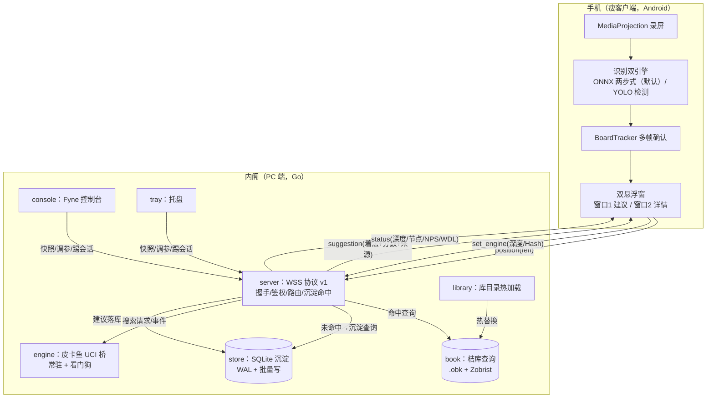
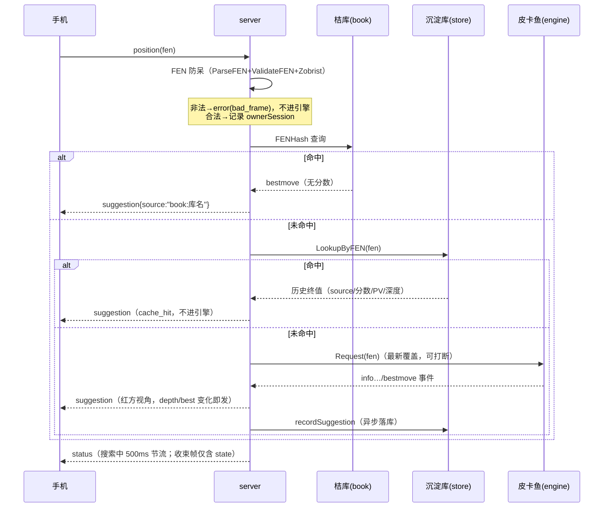
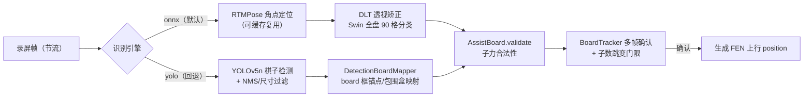

# 内阁（Cabinet）系统技术文档

> 面向开发与运维的实现现状文档。线上协议以《[protocol-v1.md](protocol-v1.md)》为准；
> 手机端 WDL 显示见《[phone-wdl-guide.md](phone-wdl-guide.md)》。
> 合规红线（不可妥协）：任何代码不得含自动走子、点击注入、无障碍服务、Root 能力。

## 1. 系统概述

手机做"眼睛"（MediaProjection 录屏 + 本地识别 + 双悬浮窗提示），电脑做"脑子"
（皮卡鱼引擎 + 桔库开局库 + SQLite 沉淀）。两端经 WSS（协议 v1）通信：局域网直连
（自签证书 + 令牌 + 证书指纹锁定），远程场景用 Tailscale 组网后仍连局域网地址（无自研中继）。



一次建议的路径：局面稳定确认 → position 上行 → PC 三级查找（桔库 → 沉淀库 → 皮卡鱼）
→ suggestion 下发（红方视角分数）→ 悬浮窗绿箭头。库命中秒回；引擎路径按目标深度
（默认 20）数秒内出解。

## 2. 仓库与运行时布局

```
cabinet/
├─ cmd/cabinet/          # 入口：装配/单实例锁/优雅关闭（-no-tray、-gen-token）
├─ internal/
│  ├─ server/            # WSS 协议 v1：编解码/握手/路由/沉淀命中/快照/手动断开
│  ├─ engine/            # 皮卡鱼 UCI 桥：常驻进程/看门狗退避/最新覆盖/运行中调参
│  ├─ book/              # 桔库 Go 移植：Zobrist 查询键 + FEN 解析校验 + 只读查询
│  ├─ library/           # books/ 目录热加载（fsnotify 防抖 + zip 自动解压）
│  ├─ store/             # SQLite 沉淀：异步批量写 / FEN 查询 / 90 天裁剪
│  ├─ console/           # Fyne 主控制台（基础区 + 折叠高级面板）
│  ├─ tray/              # Windows 托盘
│  ├─ config/            # TOML 配置（默认值生成/回填/持久化）
│  └─ logging/           # slog + lumberjack 滚动日志
├─ phone/                # Android 瘦客户端（Gradle 工程，见 §6）
├─ docs/                 # 协议/指南/本技术文档
├─ tools/                # mockphone（Go）/ mock-phone.mjs / mock-idle.mjs /
│                        #   gen-zobrist-table.py / icon_gen.py / vector-gen（Java 向量生成）
├─ scripts/allow-9527.bat  # 防火墙放行（管理员运行，幂等）
├─ testdata/             # 桔库 1234 条 Java/Go 双端比对向量
└─ reference/            # 上游参考拷贝（只读，GPL；本地部署位，不随仓库分发）
```

运行时产物（均 gitignore，不进版本库）：

| 路径 | 内容 | 说明 |
|---|---|---|
| `configs/cabinet.toml` | 实际配置（含令牌） | 首次启动自动生成默认配置 |
| `cert/server.crt|.key` | 自签证书（ECDSA P-256，10 年） | **铁律：绝不自动重建**，重建 = 全部手机需重新配对 |
| `logs/cabinet.log` | 滚动日志（10MB×5，压缩） | windowsgui 构建只写文件；console 构建双写 stdout |
| `data/suggestions.db` | 沉淀库（WAL，附 -wal/-shm） | 90 天自动裁剪 |
| `library/books/*.obk` | 桔库 | `.obk.zip` 落地自动解压、增删热加载 |
| `library/engine/pikafish.exe` | 皮卡鱼 2026-09-06 | 缺失时服务退化无引擎模式（回 not_ready） |
| `library/nnue/pikafish.nnue` | NNUE 权重 | 版权物，另行分发 |
| `assets/icon/` | 托盘/窗口图标 | 磁盘优先于内嵌资源（可覆盖不发版） |

版权物隔离：桔库 `.obk*`、`*.nnue`、手机端 `*.tflite`/`*.onnx`、皮卡鱼发布包均不进 git，
由部署者自行放置；`reference/`（GPL 拷贝）只读参考、不进编译。

## 3. PC 端模块详解（Go 1.26）

依赖：fyne/v2 2.8.1、fyne.io/systray、BurntSushi/toml、fsnotify、gorilla/websocket、
skip2/go-qrcode、lumberjack、modernc.org/sqlite（纯 Go）、golang.org/x/sys。

### 3.1 cmd/cabinet —— 装配与生命周期

- 组装顺序：配置 → 令牌（空则生成回写）→ 证书（EnsureCert）→ 指纹 → 引擎桥 → 沉淀库 →
  库管理 → WSS 服务（后台 goroutine）→ 托盘（`LockOSThread` 独立 goroutine，win32 消息循环
  同线程约束）→ Fyne 控制台（占主 goroutine，GLF 约束）。
- 单实例锁：命名互斥体 `Local\cabinet-singleton`，双开时 MessageBox 提示看托盘
  （`-no-tray` 模式静默退出）；互斥体创建失败放行（端口占用兜底）。
- 优雅关闭：ctx 取消 → 服务 Shutdown 最多 6s → 引擎退出最多 8s（超时告警可能残留
  pikafish.exe）；托盘/控制台退出互为联动（均幂等）。
- flag：`-config`（默认 `configs/cabinet.toml`）、`-gen-token`、`-no-tray`（构建标签
  `console` 时默认 true）。

### 3.2 internal/server —— 协议服务端

**协议层**：11 种帧（hello/auth/welcome/position/suggestion/status/ping/pong/error/bye/
set_engine）；单帧上限 64KiB（超出即断开）；`frameBase{v,t}` 嵌入保证 v/t 序列化在前
（有测试固化）；错误码 8 种（`rate_limited` 已定义未使用）。令牌校验
`subtle.ConstantTimeCompare` 恒时比较，防时序侧信道。

**连接与会话**：会话 ID 16 hex；写全经 `Conn.writeMu` 串行（gorilla 禁止并发写）；
连接表 `Hub`（map+Mutex）。`Welcome.books` 恒为空数组——库清单不经协议下发，走控制台展示。

**握手**（协议 §3 钉死）：PC 先发 hello → 手机 hello+auth → 10s 窗口 → welcome（携带
session_id 与引擎状态）。鉴权失败回 `auth_failed` 后断开（手机端据此停止重连）；窗口内
业务帧提示不踢。

**心跳与死链**：PC 每 15s 主动 ping 测 RTT（控制台显示）；每帧后重置读超时，
**45s 无任何帧判定死链**（= 3 个心跳周期）。手机端另有 20s 自发 ping 保活 NAT。

**position 处理（三级查找，server.go handlePosition）**：



- **建议路由**：suggestion 只发给提交该局面的连接（`ownerSession` → `Hub.SendToSession`），
  归属断开则丢弃——多设备各下各的棋，宁可不发不可错发；status 保持广播（引擎是全局状态）。
- **引擎事件泵**（enginePump）：info 帧按 lastFen 过滤（陈旧 info/预热/崩溃残留不下发）；
  depth 或 bestmove 变化立即下发，其余 500ms 节流；bestmove 为终值 + 沉淀 + 广播收束 status
  （指标清零）。分数换算 `engine.ToRedScore`（红方视角），WDL 千分比四舍五入为百分比。
- **set_engine**：先整帧校验（depth 1–40；hash 0 或 32–32768；threads 0 或 1–64；
  multi_pv 1–5）任一越界整帧拒绝；逐字段应用后按 lastFen 重搜。桌面面板调参与手机同一条路径。
- **手动断开**：控制台选行 → `Server.ConsoleKick` → `Hub.Disconnect`——按完整会话 ID 定位
  （未鉴权连接也可踢），先 bye 帧再 websocket Close 控制帧，走正常关闭分支；
  手机端按断线自动重连（不是拉黑）。

### 3.3 internal/engine —— 皮卡鱼 UCI 桥

- **常驻 + 最新覆盖**：请求槽容量 1（新请求顶掉旧请求）；搜索中新请求置 preempt + 写
  "stop"，收 bestmove 时若被打断则作废结果并排干 stop 回执（防污染下一轮）。
- **看门狗**：进程退出后自动重启；存活 <10s 记"快速失败"，连续 ≥5 次指数退避
  1.2s→2.4→4.8→9.6→19.2→30s 封顶（防坏输入死循环拖死整机），正常运行清零。
  单次搜索 60s 兜底超时（强停后再给 3s 收 bestmove）。
- **握手与参数**：uci→uciok → setoption 顺序 **EvalFile → Threads → Hash → MultiPV →
  UCI_ShowWDL true**（官方要求 Threads 先于 Hash）→ ucinewgame → isready。
  自动档：threads = 逻辑核数一半（`max(1, NumCPU/2)`）、hash = 2048MB。
- **运行中调参**：setter 只更新目标值；在下一轮搜索开始前的 UCI 空闲窗口应用，顺序
  Clear Hash → Threads → Hash → MultiPV；depth 直接体现在 `go depth N`。
- Windows 细节：子进程隐藏窗口 + CREATE_NO_WINDOW；启动后提权 HIGH_PRIORITY_CLASS
  （失败静默）。
- 事件通道容量 64，满则丢最旧保新。

### 3.4 internal/book —— 桔库查询

- `.obk` = SQLite，查询键为局面 Zobrist 哈希；`GetZobrist` 逐子异或预生成表
  （`zobrist_table.go` 由 `tools/gen-zobrist-table.py` 从 Java 原版机械生成，**勿手改**）。
- 查询 SQL 逐字对齐 Java 原版（`vvalid=1 and vkey=? order by vscore desc, vwin desc limit 5`），
  首条为最佳着法；vmove 高 8 位起点低 8 位终点。
- **FEN 防呆**：`ParseFEN` 每行必须恰好 9 格（列数不合法会让皮卡鱼直接崩溃，入口挡住）；
  `ValidateFEN` 校验双方将帅在场且不隔子照面。
- **正确性固化**：`testdata/` 1234 条 Java 端生成向量（14 锚点 + 1220 随机）双端比对测试；
  桔库文件缺失时自动 Skip。

### 3.5 internal/library / internal/store

- **library**：fsnotify 监听 books/，800ms 防抖后 reload；zip 只取 basename（防路径穿越）；
  热重建 book.Store 后回调 server 热替换（不重启服务）。无测试文件（两个无测试包之一）。
- **store**：modernc.org/sqlite 纯 Go + WAL + synchronous=NORMAL；单写 goroutine + 1024
  缓冲 channel（Save 非阻塞，满则丢弃告警，绝不阻塞协议主流程）；攒批 64 条或 500ms 一事务；
  `PruneBefore` 启动时裁 90 天前记录；`LookupByFEN` 精确匹配取最新（沉淀命中链路）；
  `Recent` 供控制台建议流。

### 3.6 internal/console / internal/tray

- **控制台**：基础区常显（①引擎仪表 ②连接表 + 证书指纹行 + 断开会话），「③ 高级功能」
  按钮排展开高级面板（调参/建议流/开局库/日志，一次一个，再点收起），窗口两档
  900×540 / 900×770。1.5s 自动刷新，取数全经 main 注入的只读回调（服务与 UI 解耦）。
  跨 goroutine UI 更新一律 `fyne.Do`。
- **连接二维码**：payload `cabinet://connect?u=<wss>&k=<令牌>&f=<指纹可选>`；网卡下拉按
  "物理网卡优先 → 私网段排序"，防 VMware/Docker 虚拟网卡排前。
- **托盘**：动态状态行（2s 刷新，回调包 recover）；左键唤出面板；「连接二维码」「打开日志
  目录」「退出」（退出 = 取消 ctx，关闭全链）。图标磁盘 `assets/icon/cabinet.ico` 优先于内嵌。

### 3.7 配置项参考（configs/cabinet.toml）

| 字段 | 默认值 | 说明 |
|---|---|---|
| `bind` | `":9527"` | WSS 监听地址 |
| `token` | （空） | 64 hex 配对令牌；空则首次启动生成回写；仍空拒绝启动 |
| `tls.cert_dir` | `"cert"` | 自签证书目录（绝不自动重建） |
| `log.level` | `"info"` | debug/info/warn/error |
| `log.file` | `"logs/cabinet.log"` | 空 = 仅控制台 |
| `log.max_size_mb` / `max_backups` | 10 / 5 | lumberjack 滚动 |
| `engine.enable` | `true` | false = 无引擎模式（position 回 not_ready） |
| `engine.path` | `library/engine/pikafish.exe` | 引擎可执行文件 |
| `engine.nnue` | `library/nnue/pikafish.nnue` | EvalFile 权重 |
| `engine.threads` | `0` = 自动 | 自动 = 逻辑核数一半 |
| `engine.hash_mb` | `0` = 自动 | 自动 = 2048MB |
| `engine.multi_pv` | `3` | 变招路数 |
| `engine.depth` | `20` | 目标深度（固定深度制） |
| `library.books_dir` | `"library/books"` | 桔库目录（热加载） |
| `store.enable` | `true` | 建议沉淀开关 |
| `store.path` | `"data/suggestions.db"` | SQLite 路径 |

缺失键自动回填默认值；`configs/cabinet.example.toml` 为全量注释示例。

## 4. 手机端模块详解（Android，minSdk 26 / target 34）

依赖：OkHttp 4.12（WSS）、zxing-embedded 4.3（扫码）、tensorflow-lite 2.14（YOLO）、
onnxruntime-android 1.17.1（ONNX）。applicationId `com.cabinet`。

### 4.1 识别管线（双引擎）



- **ONNX 两步式（默认）**：RTMPose 全图定位棋盘 4 角（成功即缓存，后续帧跳过定位提速
  约 35%；识别异常连续 3 帧失效缓存自愈）→ 单应透视变换俯视图 → Swin 分类解码 90 格。
  对未收录棋盘皮肤泛化好，4 角语义天然定朝向。
- **YOLO 检测式（回退）**：YOLOv5n fp16（640×640）检测 14 子 + board 框，置信度 0.60 +
  类别感知 NMS + 尺寸一致性过滤；board 框锚定网格，缺失时棋子包围盒兜底。
  NNAPI 可选（默认关，各机型差异大）；ONNX 加载失败自动回退 YOLO。
- **确认机制**：连续 `confirmCount`（默认 3）帧同一局面 + 子力合法性（各子种数量上限）
  + 子数跳变门限（±max(2, 子数/10)，滤幻觉帧）+ 重开检测（≥32 子回开局 → NEW_GAME）。
  **是子力校验而非走法规则校验**——识别噪声靠多帧一致性把关。
- **悬浮窗零闪烁**：双帧差签名槽（可见/遮挡两套基线，稀疏采样）——静止画面零推理零隐藏；
  抓干净帧前 alpha 隐藏两窗 + 丢旧帧；窗口-棋盘相交判断决定是否需隐藏。

### 4.2 协议客户端（RemoteAnalysisClient）

- 握手/重连/心跳/not_ready 恢复严格对齐协议 v1：重连 1s→30s 指数退避；welcome 后重发最近
  position（最新覆盖幂等）；20s 自发 ping；`auth_failed` 停止重连。
- **TLS 指纹锁定**：配了指纹（64 位 hex，容忍冒号/大小写）→ 校验链首证书 SHA-256，
  不匹配断开并给出中文排障指引；指纹格式非法直接拒绝连接（**绝不静默降级为不校验**）；
  空 = 联调模式信任自签。指纹经配对二维码 `f` 参数带外分发，二维码为权威来源
  （不带 f 即清空本地旧指纹）。
- 建议 UI 语义：开局库命中即绿箭头；引擎建议稳定 1.2s（或收束 status）转绿；
  "送子防线"——建议起点必须是我方棋子，防幽灵 FEN 误导走子；对方回合仅展示文字预案。

### 4.3 配置项参考（SharedPreferences `assist_settings`）

| 配置项 | 默认 | 说明 |
|---|---|---|
| `serverUrl` / `serverToken` | 空 | 电脑地址 / 配对令牌（扫码或手输，输入即存） |
| `certFingerprint` | 空 | 证书指纹（setter 自动归一化；空 = 不校验） |
| `recognizerEngine` | `"onnx"` | 识别引擎 onnx/yolo（主页单选即时切换） |
| `useNnapi` | false | YOLO NNAPI 加速（默认关） |
| `confirmCount` | 3 | 稳定确认帧数 1..8 |
| `singleMoveRepair` | true | 走子连贯性修正：确认时刻枚举单步走子解释"差 1 格"漏检并修正 |
| `engineDepth` / `engineHashMB` / `engineThreads` | 20 / 256 / 0 | set_engine 档位循环值（threads 0 = 自动档） |
| `engineMultiPv` | 1 | 变招路数档位（悬浮窗按钮循环，1–5） |
| `benchProfiling` | false | 识别分段计时（每次识别多打一条 timing 日志；诊断开关，adb 改 shared_prefs） |
| `overlayPos` / `overlayDetailPos` / `overlayTheme` | — | 双窗位置（归一化）与主题 |

模型资产（不进 git，另行分发）：`assets/yolov5n_xq_fp16.tflite`（3.8MB）、
`assets/models/4_v6-0301.onnx`（RTMPose 角点，10.7MB）、`assets/models/nano_v3-0319.onnx`
（Swin 分类，10.9MB 动态量化版——int8 权重 + fp32 激活；上游发布的 fp32 原版 31.1MB
不进包，留作精度参照）。推理加速：arm64 真机启用 XNNPACK + 4 线程（x86_64 模拟器
上 XNNPACK 会 native 崩溃，已实测，按主 ABI 门控恒走纯 CPU；EP 创建失败自动回退）。

## 5. 安全模型

| 层 | 机制 | 备注 |
|---|---|---|
| 传输 | TLS 1.2+，自签证书 ECDSA P-256 | 证书 10 年，一经生成绝不自动重建 |
| 服务器身份 | 证书 SHA-256 指纹锁定 | 二维码 `f` 参数带外分发；空 = 联调模式 |
| 客户端鉴权 | 64 hex 令牌，恒时比较 | 令牌明文出现在二维码（仅限本机屏幕展示） |
| 会话管理 | 控制台可手动断开任一会话 | bye 优雅关闭；非拉黑 |
| 合规 | 无自动走子/点击注入/无障碍/Root | 手机端仅悬浮窗提示，人工走子 |

## 6. 测试体系

**PC 端（`go test ./...`，全绿）**：

| 包 | 覆盖点 |
|---|---|
| server（31 个测试） | 协议 round-trip 与字段顺序、恒时令牌、证书铁律（不覆盖/损坏报错/指纹口径）、真 TLS 全链路握手/踢出/超时/ping 保活、陈旧 info 过滤、黑方换算、not_ready、set_engine 校验、非法 FEN、**建议路由不串台**、**沉淀命中不进引擎**、**手动断开** |
| engine（14 个） | 握手、搜索流、红方换算、最新打断、崩溃后 preempt 残留回归、看门狗重启、超时强停、info 解析、调参边界/顺序/生效时机、自动档默认值、退避延迟表 |
| book（6 个） | **1234 条 Java/Go 双端向量固化**（哈希+查询）、镜像/黑先、多库优先级、FEN 行宽 |
| store / config / console / tray | 沉淀批量与队列满不阻塞、FEN 查询、裁剪、配置往返、格式化与二维码 payload、图标加载 |

**手机端**：`AssistConfigFingerprintTest`（指纹归一化 5 例）、`OnnxGeomTest`
（仿射/单应/采样/解码 12 例）。

**联调工具**：`tools/mockphone`（Go，模拟完整对局帧流）、`tools/mock-phone.mjs`
（Node，`NODE_TLS_REJECT_UNAUTHORIZED=0` 跑自签）、`tools/mock-idle.mjs`
（保活连接，供断开会话 UI 实测）。模拟器（x86_64）可验 UI/识别管线/协议链路；
引擎相关验证需 arm64 真机。

**静态检查基线**：`go vet` 全绿；`deadcode -test` 与 `staticcheck U1000` 定期清理
（当前零死代码）；`gofmt` 强制。

## 7. 部署与运维

**首次部署（PC）**：

1. 放置版权物：`library/engine/pikafish.exe`、`library/nnue/pikafish.nnue`、
   `library/books/*.obk(.zip)`。
2. 构建：`CGO_ENABLED=1 go build -ldflags "-H windowsgui" -o cabinet.exe ./cmd/cabinet`
   （需 MinGW-w64，本机在 `.tools/mingw64-extract/`；GOPROXY=goproxy.cn）。
   无托盘场景：`go build -tags console -o cabinet-console.exe ./cmd/cabinet`。
3. 首次启动自动生成：默认配置（含随机令牌，日志可见）、自签证书、目录结构。
4. 防火墙：管理员运行 `scripts/allow-9527.bat`。
5. 配对：控制台「连接二维码」→ 手机扫码（自动填地址/令牌/指纹）→ 开始屏幕识别。

**日常运维**：

| 场景 | 处理 |
|---|---|
| 换库 | `.obk(.zip)` 丢进 `library/books/`，800ms 防抖后热加载，无需重启 |
| 沉淀库增长 | 自动裁剪 90 天前记录；「③ 建议流 → 清空沉淀」全清 |
| 双开 | 第二实例弹窗提示（不静默假死） |
| 引擎反复崩溃 | 日志出现退避（1.2s→30s 封顶）；排查 NNUE/引擎文件完整性 |
| 手机连不上 | 按手机端提示排障：超时≈IP/防火墙，拒绝≈未启动，指纹不匹配≈重签证书（重新扫码） |
| 远程接入 | 两端装 Tailscale，手机仍连 PC 的 Tailscale IP（协议/指纹不变） |

**日志**：`logs/cabinet.log`（滚动压缩）；关键行：启动摘要（证书 sha256/引擎参数）、
`沉淀命中…cache_hit=true`、`手动断开会话`、看门狗退避告警。

