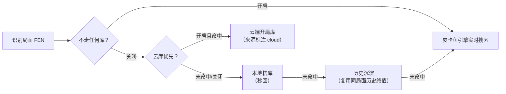

# 内阁（Cabinet）用户说明书

本手册逐一介绍内阁的**每个功能**：它是什么、在哪找到、怎么用。安装与升级请看
[小白更新手册](小白更新手册.md)；架构与实现细节看
[系统技术文档](technical-overview.md)。

内阁分两端协同工作：**手机是"眼睛"**（录屏识别棋盘局面），**电脑是"脑子"**
（皮卡鱼引擎 + 开局库实时分析），分析结果以悬浮窗呈现在手机对局界面上。

```
手机（识别局面）──WSS 加密──▶ 电脑（引擎分析）──建议──▶ 手机（悬浮窗显示）
```

---

## 目录

- [电脑端](#电脑端)
  - [托盘菜单](#托盘菜单)
  - [控制台总览](#控制台总览)
  - [01 引擎面板](#01-引擎面板)
  - [02 开局库面板](#02-开局库面板)
  - [03 连接面板](#03-连接面板)
  - [04 走势面板](#04-走势面板)
  - [05 高级功能面板](#05-高级功能面板)
- [手机端](#手机端)
  - [主页与配对](#主页与配对)
  - [双悬浮窗](#双悬浮窗)
  - [建议箭头语义](#建议箭头语义)
- [建议从哪来](#建议从哪来)
- [数据与隐私](#数据与隐私)

---

## 电脑端

启动 `cabinet.exe` 后它驻留在**系统托盘**（屏幕右下角），不占任务栏。
所有电脑端功能都在托盘菜单与控制台里。

### 托盘菜单

- **左键单击图标**：直接打开控制台。
- **状态行**：当前引擎状态与连接数，2 秒刷新，无需点开即知概况。
- **连接二维码**：弹出扫码配对窗口（手机第一次配对或换手机时用）。
- **打开日志目录**：打开日志文件夹（排障时把里面的文件发给维护者）。
- **退出**：完全退出（结束手机连接、引擎、托盘；数据不受影响）。

### 控制台总览

控制台是一个"便当盒"式单窗口，从上到下五个区块；**01/02/03/04 常显**，
「05 高级功能」是一排按钮，点按钮展开对应面板，再点收起：

<p align="center"></p>

- **01 引擎**（左上）：引擎状态仪表
- **02 开局库**（右上）：本地库 + 云库开关
- **03 连接**（中部通栏）：已配对手机的连接管理
- **04 走势**（通栏）：当前对局的局势曲线
- **05 高级功能**（按钮排）：引擎调参 / 建议流 / 开局库详情 / 日志 / 检查更新

窗口高度随内容自适应；面板内容特别长时（如建议流）在盒内滚动，不会被窗口
下沿裁掉。

### 01 引擎面板

显示皮卡鱼引擎的实时工作状态，每 1.5 秒自动刷新：

| 项目 | 含义 |
|---|---|
| 状态 | `就绪`（正常）/ `加载中`（启动中）/ `错误`（看日志）/ `未启用`（引擎未启用） |
| 深度 / 目标 | 深度制下的搜索进度：已搜到的层数 / 目标层数（默认 20） |
| 用时 / 上限 | 时间制下的搜索进度：本轮已搜秒数 / 时间上限 |
| 节点 | 本次搜索已计算的节点数（搜索越深越大，正常现象） |
| 搜索速率 | 每秒节点数（n/s），衡量电脑算力利用率 |
| 哈希 | 哈希表占用（已用/总量） |
| 配置 | 当前线程数与变招路数（完整值在「引擎调参」面板） |
| 模式 | 深度制 / 时间制及其档位 |
| 今日建议 | 今天累计下发的建议条数 |

**深度制与时间制**是两种搜索方式：深度制固定算到第 N 层；时间制给一个
时间上限，到点交卷。切换在手机悬浮窗"思考"芯片上操作（见后文），电脑端
仪表自动跟随。

### 02 开局库面板

| 项目 | 操作/含义 |
|---|---|
| 收录局面 | 本地全部桔库（.obk）的局面总数 |
| 今日命中率 | 今天开局库命中了多少条建议（命中即秒回，不用引擎算） |
| 云库查询（勾选框） | 开启后：本地桔库与沉淀都未命中时，向云端开局库（默认 chessdb.cn，免费公开基建）查询该局面。查询异步、限速、结果缓存、失败静默——**失败不影响引擎建议** |

> ⚠️ 隐私口径：开启"云库查询"后，对局局面（FEN）会发往云端端点。
> 不联网对局请保持关闭。

> "默认走云库"开关在 **05 高级功能 → 开局库** 面板（见下文）。

### 03 连接面板

管理全部已连接的手机：

| 功能 | 用法 |
|---|---|
| 连接列表 | 每行一台设备：昵称（手机端可改）、客户端版本、网络往返延迟（RTT）、最近识别局面。列表高度恒定，连接增减只在盒内滚动，不推移下方面板 |
| 断开会话 | 点选某行后点「断开」，把该手机踢下线（手机会自动重连） |
| 生成配对二维码 | 弹窗选网卡 → 生成二维码；网卡下拉按"物理网卡优先 → 私网段排序"，虚拟网卡（VMware/Docker）排后面。手机扫码一次带入地址、令牌、证书指纹 |

> 断开的手机会按指数退避自动重连（1s 起步、最长 30s），无需在手机上操作。

### 04 走势面板

当前对局的**局势曲线**：横轴是建议序号（对局进程），纵轴是**我方视角**的
局势分——上方（朱砂）= 我方优，下方（靛青）= 我方劣，±600 厘分（cp）顶格，
将杀直接顶格。每条建议记一个点；同一局面重复出建议不重复记点（切换引擎
参数重搜也不会产生锯齿）。

- 头部小字实时显示"我方胜率 xx%"（或"我方分值"），颜色随优劣变化。
- 手机上报了执色时按**我方视角**显示；旧版手机未上报时退回红方视角，文案
  前缀如实标注"红方"。
- **多台手机**时头部出现设备按钮（实心 = 当前查看的设备），点按钮切换看
  各自的曲线；单台设备不显示按钮。设备断联后按钮隐藏，重新连接即恢复——
  断联期间的历史曲线保留可回看。
- 曲线是被动展示的背景信息：没有任何操作控件，不与棋局争夺注意力。

### 05 高级功能面板

一排按钮，点开对应面板（一次一个，再点收起）：

**引擎调参**——不重启对局热调引擎参数：

| 参数 | 说明 |
|---|---|
| 深度 | 深度制目标层数 |
| Hash | 哈希表大小（MB），越大越吃内存越强 |
| 线程 | 0 = 自动（物理核一半），手动为逻辑核数 |
| 变招（MultiPV） | 引擎同时算几路候选；调大棋力略降（变招按钮需要 ≥2 才有多路可切） |
| 思考模式 | 深度制 / 时间制切换与档位；改动与手机悬浮窗联动 |

调整后立即生效并**落盘到配置文件**，重启电脑后保持。

**建议流**——最近 50 条下发的建议记录（时间 / 来源 / 局面 / 最佳着法 /
分数 / 深度），可清空沉淀。数据存在本机 SQLite（`data/suggestions.db`），
同时它就是"沉淀"功能的数据库（见[建议从哪来](#建议从哪来)）。

**开局库详情**——各桔库的收录与加载状态；面板内两个开关勾选框：

- **「默认走云库（优先于本地库与引擎）」**：需先开启"云库查询"。开启后每步
  **先问云库**——命中即直接采用（不再查本地库、不进引擎，最省算力）；未命中
  自动回落本地库与引擎。
- **「不走任何库（每步引擎直搜）」**：开启后跳过**全部**库——桔库、沉淀、
  云库都不查，每一步都由引擎实时计算（想要纯引擎出招时用）。优先级高于
  "默认走云库"（同时勾选时以本开关为准）；建议仍照常记录进建议流。

两个勾选状态都独立持久（落盘重启保持），可先勾后开对应总开关。

**日志**——最近日志尾部实时滚动（WARN 琥珀色、ERROR 红色）；上翻看历史
不会被打断，翻回底部恢复自动跟随。

**检查更新**——查询 GitHub 上的最新稳定版；查到新版后**经你确认**才会下载
安装，绝不静默自动。安装流程全自动备份回滚（断电自愈），更新内容只换
`cabinet.exe`，配对与数据不受影响。详阅[小白更新手册](小白更新手册.md)。

---

## 手机端

安装 APK 后打开即是主页。全部功能围绕"连上电脑 → 自动识别 → 悬浮窗看建议"。

### 主页与配对

- **连接**：填电脑地址（扫码自动填）+ 令牌，或直接**扫电脑端配对二维码**
  一次完成三项配置。配对成功后记忆在手机本地，之后自动重连。
- **证书指纹**：随二维码自动带入并锁定——电脑证书若被重建过，手机会拒绝
  连接并给出中文提示（重新扫码即恢复）。
- **设备昵称**：自定义本机显示名，出现在电脑端连接列表与走势设备按钮上；
  清空则回退机型名。
- **悬浮窗主题**：黑 / 深 / 浅三选一单选，切换即时应用到运行中的悬浮窗。
- **识别引擎**：主页单选 `onnx`（默认，两步式：先定位棋盘四角再逐格分类，
  泛化好、定位可缓存提速约 35%）/ `yolo`（回退，棋子检测式；ONNX 加载失败
  也会自动切到它）。运行中即时切换。
- **确认帧数**：连续 N 帧（默认 3）识别出同一局面才认定成立，防识别噪声。
  调大更稳但反应稍慢。
- **走子连贯性修正**：确认时刻若发现盘面与上一步恰好"差一格"，自动枚举单步
  走子修正漏检，减少偶发识别误差。

### 双悬浮窗

对局中叠在象棋 App 上的两个独立小窗，位置各自拖动记忆：

- **主窗**：建议箭头（画在棋盘上，指向推荐落点）+ 红黑胜率 + 状态行 +
  小棋盘缩略图 + 一排功能按钮（下表）。Android 14+ 的录屏授权（MediaProjection）
  为一次性：每次录屏会话结束需重新授权，在连线页重新点亮即可。
- **详情窗**：引擎深度 / 节点数 / WDL（胜-和-负概率条）/ 引擎状态；默认不
  打开，点主窗「详情」按钮开关。

主窗按钮一览（网格排布，从左到右逐个说明）：

| 按钮 | 短按作用 |
|---|---|
| 停止 / 继续 | 停止实时指导（悬浮窗保留、不再刷新建议）；改动棋盘后自动恢复 |
| 变招 | 在引擎的多路候选间轮换（需电脑端「路数」≥2；单候选时提示指引） |
| 悔棋 | 回退到上一个已确认局面（识别错帧、误确认时用；历史随对弈自动积累） |
| 手动 | 手动模式：识别彻底失效的应急——点棋盘选子，再点目标格走子/删子；再点一次退出并恢复自动识别 |
| 棋局 | 一键翻转走子方并按新轮次重建分析（识别差分偶发失败导致"轮到对方走"卡住时用） |
| 思考 | **单芯片**：短按 = 当前模式内循环档位（深度 12–40 层 / 时间 1–20 秒）；**长按** = 深度制 ↔ 时间制切换（时间值记忆不清零）。芯片文案实时显示现行值，与电脑端联动 |
| 哈希 | 哈希档循环（即时上行电脑热改） |
| 路数 | 变招路数 1–3 循环（热改电脑引擎 MultiPV，下一轮搜索生效） |
| 详情 | 详情窗显隐切换 |
| 关闭 | 两段确认防误触：第一次变红显示"确认?"，再点才真正关闭（停止录屏并移除悬浮窗，可在连线页重新启动） |

小棋盘缩略图也可点击轮换候选（与「变招」同效）。

### 建议箭头语义

- **我方回合**：箭头指向推荐落点；开局库或云库命中（确定性建议）到达直接
  绿箭头，主窗文案标注来源（"开局库·桔库" / "云库·chessdb.cn"）；引擎建议
  稳定约 1.2 秒后转绿（避免闪烁）。
- **云库命中标注**：开着"云库查询"（但没开"默认走云库"）时，云端库与引擎
  是同时工作的——若引擎算出的着法与云库一致，建议稳定后文案带 **"· 云库"**
  标注（如"建议 炮二平五 ✓ · 云库"），详情窗显示"来源 云库·chessdb.cn"，
  告诉你这手棋云端库也有记录。
- **对方回合**：只展示文字预案，不画箭头——轮到你时箭头才出现。
- **送子防线**：建议起点必须是我方棋子，识别偶发出错也不会指着一颗不存在的
  子让你走。

---

## 建议从哪来

电脑端按下面的顺序产生建议，**命中即停**（后面的不跑）：



- 悬浮窗建议的**来源透明标注**与箭头颜色语义见
  [建议箭头语义](#建议箭头语义)。
- "默认走云库"开启时云库插队为第一来源（见 02 面板说明）；关闭时云库只在
  桔库与沉淀都未命中时作异步补充。

---

## 数据与隐私

- **全部数据都在程序目录里**（`appdata/`、`configs/`、`data/`、`logs/`）：
  不写注册表、无安装器，文件夹删掉即彻底卸载，备份 = 复制文件夹。
- 配对**令牌只存哈希**，服务器侧拿不到原值；证书指纹锁定防中间人。
- 识别的只有**棋盘局面**（FEN 棋子位置），不采集任何其他屏幕内容。
- 云库查询按上表口径发送 FEN；不开即不发送。
- 日志只写本机 `logs/`，不上传。
