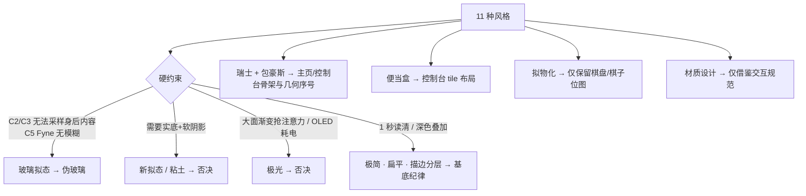
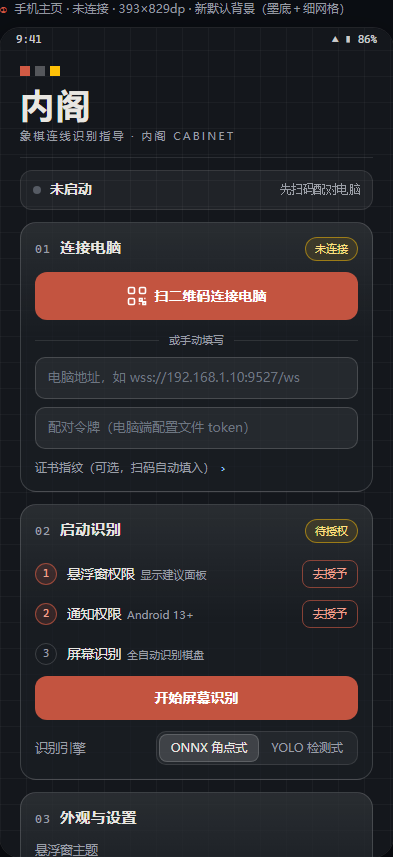
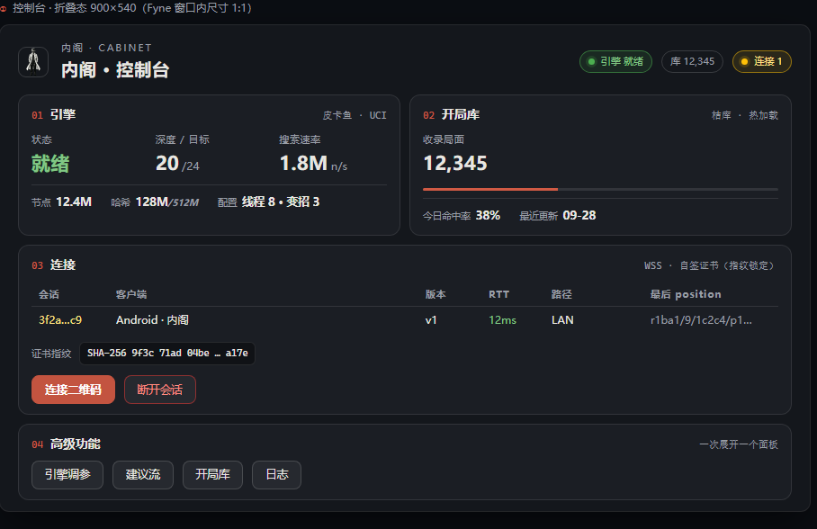

# 内阁 · 双端美学设计研究

> 对象：手机端 APK（`com.cabinet`，悬浮窗 HUD 为核心）＋ 电脑端 Fyne 控制台＋托盘
> 方法：以真实素材与真实几何渲染真尺寸视觉稿逐张评审；11 种指定风格逐一适配分析；每条设计点标注两端的可实现手段
> 产出：本报告 ＋ `docs/design/视觉稿总览.html`（可交互）＋ 9 张真尺寸 PNG（`docs/design/*.png|jpg`）
> **落地状态（2026-10-02）**：本报告设计已实施到 `phone/` 与 `internal/console`（记录见 §7.5；
> 模拟器截图验收见 §7.4 T5；`docs/console-screenshot.png` 已按新界面重拍）

---

## 一、结论摘要

**推荐设计语言：棋韵（Qi）三态体系** —— 三块界面各取所长、共享一套语义 token：

| 界面 | 风格定位 | 一句话原则 |
|---|---|---|
| 悬浮窗主面板 / 详情窗 | 极简主义 × 玻璃拟态 | HUD「一眼原则」：轮次与优势是一行大字，其余全部降噪 |
| 手机主页 | 瑞士国际主义 × 包豪斯 | 网格＋大字＋细线＋几何序号；强调色只留朱砂一支 |
| 电脑控制台 | 便当盒布局 × 瑞士 | 等权信息进 tile；数字等宽；状态点与手机端同一套语言 |
| 托盘 / 扫码页 | 极简主义 | 与桌面同色系，不做多余装饰 |

**九条关键决策**（每条都有量化或约束依据，正文展开）：

1. **朱砂统一**：手机端 `#BF360C` 与电脑端 `#D05A44` 收敛为同一支主色；另设「朱砂·按 `#C35440`」专用于白字实心底（白字对比 4.02 → **4.5:1**，满足 WCAG AA 正文）。
2. **主页默认背景改为「墨底 ＋ 细网格」**：现有默认背景 `chessbg.jpg` 是 1600×1800 亮绿竹叶插画，与墨底朱砂体系冲突、文字对比不可控；自定义图片统一叠加 ≥80% 压暗层（视觉稿 ② 已用真实竹叶图验证可读性）。
3. **悬浮窗伪玻璃**：半透明 ＋ 高光描边 ＋ 顶部微渐变。**真背景模糊在物理上不可得**——Android 悬浮窗（`FLAG_SECURE` ＋ 覆盖他人应用）无法采样身后内容，Fyne 亦无模糊能力。视觉稿按可实现效果渲染，不做假。
4. **保持 392×197dp 与 11sp 按钮契约**，只重排信息架构：轮次/优势提炼为大字、候选改点阵、按钮分「值芯片 / 动作按钮」两级。实测占屏 23.7%，默认位置对棋盘遮挡 **0%**（遮住的是对手 App 的控制区）。
5. **建议箭头描边加深** `#2E7D32 → #1B5E20`（木色棋盘上 2.9 → **4.45:1**）；填充 `#A5D6A7` 不承担对比（由描边承担），视觉稿已按新值绘制。
6. **等宽数字**贯穿两端的数值界面（Android `tnum`、Fyne monospace），深度/节点/速率不再跳变。
7. **描边分层替代阴影**：卡片与按钮用 1dp 半透明描边（`#1AFFFFFF`/`#29FFFFFF`/`#47FFFFFF` 三档）分层，不用投影——深色叠加场景下阴影既不可见也不可靠。
8. **否决 新拟态 / 粘土拟态 / 极光**（理由见 §3.8/3.9/3.11）；**拟物化**只保留在棋盘与棋子位图（功能性拟物：识别载体，不做 UI 皮肤）；**材质设计**只借鉴其交互规范（触达尺寸、状态层、动效时长），不引入其皮肤。
9. **主页内容 1068dp ＞ 视口 805dp**：首屏留给「头部＋状态＋连接卡＋启动卡」，外观与设置滚动可见；落地时建议把「外观与设置」折叠或下沉（§7.4 追踪项）。

---

## 二、研究方法与评审维度

### 2.1 硬约束（先于审美）

设计不能违反的既有事实，全部来自代码与平台能力：

| # | 约束 | 来源 | 对设计的影响 |
|---|---|---|---|
| C1 | 悬浮窗 392×197dp 固定尺寸、按钮 11sp 下限（36dp 网格内「深度24」不溢出） | `ScreenAssistService.ensureOverlay()`、`OverlayPanelView`、`styles.xml` 注释 | 视觉稿不得突破；重排只能在这个盒子里做 |
| C2 | 悬浮窗 `FLAG_SECURE` ＋ 覆盖他人应用 | `ScreenAssistService` | **无法采样身后内容 → 无真背景模糊**；只能伪玻璃 |
| C3 | minSdk 26 | `phone/app/build.gradle.kts` | `RenderEffect` 模糊（API 31+）不能依赖；玻璃只能做半透明叠加 |
| C4 | 棋盘与棋子为位图（1240×1340 底图 ＋ 14 张棋子 PNG，几何 `center(x,y)=(77+136x, 60+136y)`） | `OverlayChessView.kt` | 迷你棋盘是"微缩原版"，视觉稿与其逐一对应（视觉稿中的棋盘由同一几何与同一素材渲染） |
| C5 | 电脑端是 Fyne（canvas 绘制类框架） | `internal/console/*.go`（fyne v2.8.1） | 无模糊、无软阴影、渐变有限（v2.4+ 有 `canvas.LinearGradient`）；设计必须是"矩形＋圆角＋描边＋字体"可表达的 |
| C6 | 私有单机工具（作者自用，闭源） | README「All Rights Reserved」 | 没有品牌营销诉求 → 效率、耐看、低干扰优先于"潮流感" |
| C7 | 两端现状 token 不一致（手机主色 `#BF360C` vs 电脑 `#D05A44`） | 现状代码 | 需要一次统一，否则"同一产品"的观感断裂 |

### 2.2 评审维度（5 维）

1. **注视距离与信息密度**：对弈中斜视 30–50cm，状态必须 ≤1 秒读清（决定悬浮窗的字号与信息层级）。
2. **遮挡与叠加可读性**：悬浮窗叠在棋局上，任何视觉元素必须"读得出、不抢戏"（决定伪玻璃与描边策略）。
3. **暗环境与 OLED 友好**：对弈常在夜间/弱光；纯黑档在 OLED 上省电（决定三档主题的存在与配色）。
4. **技术可实现性**：C1–C5 的边界内能否落地、成本多大（决定采纳与借鉴的分界）。
5. **与「象棋·内阁」身份契合**：棋盘/棋子/朱砂/墨色的东方棋具语汇是否被强化（决定色彩与拟物的取舍）。

### 2.3 现状基线（评审前记录，便于对照）

| 项 | 手机端现状 | 电脑端现状 |
|---|---|---|
| 主色 | `#BF360C`（深橙红） | `#D05A44`（象棋红） |
| 强调色 | 琥珀 `#FFCC80`（分组标题）＋ 浅蓝 `#90CAF9`（状态）＋ 白 ＋ 红，**四种互抢** | 仅主色一支 |
| 面/底 | 卡片 `#D9141C2B`、悬浮窗 `#B31B1E24` | `#1B1E24` / `#14171C` |
| 描边 | 1dp `#24FFFFFF`/`#2EFFFFFF`/`#40FFFFFF`/`#55EEB74C` **四套无命名** | 1 套 |
| 字号 | 11/12/13/14/15/22/28sp 七档无阶梯定义 | 默认 ＋ 仪表 22pt |
| 圆角 | 10/12/16/18dp 四级无命名 | 默认 |
| 资源化 | **无 colors.xml / dimens.xml / themes.xml**，色值 90% 内联 | theme.go 集中 |
| 背景 | `chessbg.jpg`：1600×1800 亮绿竹叶插画（带光斑） | 纯色 |
| 文档 | 无设计文档 | 无设计文档；`docs/console-screenshot.png` 为**过期浅色旧图** |

---

## 三、11 种风格逐一研究

每种给出：源流与视觉特征 → 对本项目三界面的适配 → 结论。汇总见 §3.12。

### 3.1 瑞士国际主义（Swiss / International Typographic Style）

- **源流与特征**：1950 年代苏黎世与巴塞尔；无衬线字体、数学网格、非对称留白、客观与秩序；代表：Müller-Brockmann 的网格系统、Helvetica。
- **适配**：主页与控制台的"信息层级"骨架天然契合——功能型工具最需要的是层级与秩序，而不是装饰。悬浮窗不适用（面积太小，网格排不开）。
- **落地要点**：标题/微标/细分割线三级结构；左对齐、大留白；编号（01/02/03）替代图标做分区标识。
- **结论：采纳**（主页 ＋ 控制台骨架）。

### 3.2 包豪斯（Bauhaus）

- **源流与特征**：1919 德绍；几何构成（方/圆/三角）、三原色、形式追随功能；把字体与版面当构成元素。
- **适配**：与象棋的"几何棋盘"同源。用作**标记系统**（方点标记、几何序号圆点、状态点），视觉上给出"构成感"而不增加理解成本。
- **落地要点**：三原色收敛为 朱砂（主）＋ 玉（就绪）＋ 琥珀（等待）三色语义，**不做三原色平铺**，否则玩具化且破坏状态语义。
- **结论：采纳**（几何标记与序号系统）。

### 3.3 拟物化（Skeuomorphism）

- **源流与特征**：模拟真实材质与物理反馈（皮革、木纹、玻璃质感按钮）。
- **适配**：本项目已有一处**极高质量的拟物资产**：棋盘底图 ＋ 14 张棋子位图，且与真实对局画面一一对应——这是识别的"锚点"，用户靠它把悬浮窗与眼前棋局对齐。但 UI 外壳（卡片/按钮/输入框）拟物化会带来：深色叠加场景下阴影不可靠、信息密度下降、与 Fyne 能力冲突。
- **结论：部分保留** —— 棋盘与棋子维持位图拟物（并继续作为视觉身份核心）；**UI 外壳去拟物**。

### 3.4 扁平化（Flat Design）

- **源流与特征**：去阴影、去渐变、纯色块与字形承担层级。
- **适配**：与 C5（Fyne 无软阴影）与 C2（叠加场景）完全一致；也是本方案"描边分层"的底色纪律。
- **结论：采纳为基底纪律**。

### 3.5 材质设计（Material Design）

- **源流与特征**：纸张与墨水的隐喻、elevation 层级、状态层（state layer）、Ripple、动效时长体系（100/200/300ms）、48dp 触达尺寸。
- **适配**：其**交互规范**（触达尺寸、按压反馈、动效时长、禁用态明确）对手机端有直接价值；其**视觉皮肤**（elevation 阴影、大面积色彩容器）在深色悬浮窗场景不适用，且与 Fyne 端不可共享。
- **结论：借鉴交互规范，不引入视觉皮肤**。落地时手机端允许引入 `com.google.android.material` 以获得 Ripple 与组件质量（见 §7.1），但视觉参数按本报告 token 覆盖。

### 3.6 极简主义（Minimalism）

- **源流与特征**：去除一切非必要元素；"少即是多"。
- **适配**：**悬浮窗的第一原则**。现状问题正是极简的反面：状态区是一段最多 8 行的 13sp 文字（"候选1/3 建议 炮二平五（暂定）／红方优势 +0.8 深度20／我方红方／轮到我方走"），需要逐行阅读；6 个按钮同权重同尺寸。
- **落地要点**：同屏字号阶梯 ≤3 级；把"轮次/优势"提为一等公民，其余降为次级；低频操作（关闭/详情）保持存在但不抢视觉权重。
- **结论：采纳**（悬浮窗主导原则）。

### 3.7 玻璃拟态（Glassmorphism）

- **源流与特征**：半透明背景 ＋ 背景模糊 ＋ 1px 高光描边；让浮层"悬浮于内容之上"。
- **适配**：悬浮窗与主页卡片都受益——但必须区分**真玻璃**（背景模糊）与**伪玻璃**（半透明 ＋ 高光 ＋ 微渐变）：
  - Android 悬浮窗：C2 决定**不可能**真模糊（无法采样身后内容）；`FLAG_BLUR_BEHIND` 早已废弃，`RenderEffect` 只作用于自身内容。
  - Fyne：无模糊 API（C5）。
  - ⇒ 只能伪玻璃。伪玻璃的可靠性来自两点：**足够的底色不透明度**（72%，保证文字对比）＋ **1px 高光描边**（区分浮层边界）。视觉稿已按此渲染。
- **结论：采纳为"伪玻璃"**，并在文档与代码注释中写明物理限制，避免后人误以为可以做真模糊。

### 3.8 新拟态（Neumorphism）

- **源流与特征**：同色系实底上的一对明暗软阴影，造出"挤压/凸起"的塑料感。
- **否决理由**（三条，任一条即致命）：
  1. **与半透明叠加根本冲突**：新拟态要求背景是完全可控的实底；悬浮窗必须让棋局透出，凸凹的明暗关系全部失效。
  2. **对比度天生偏低**：其"弱对比"美学与 C1/C2 的"1 秒读清"直接对立；在强光或低质量屏幕下不可用。
  3. **Fyne 无软阴影**：即使手机端能做（layer-list 双阴影），电脑端也无法同构，破坏两端一致性。
- **结论：否决**（并在设计评审中作为"禁止变形"记录）。

### 3.9 粘土拟态（Claymorphism）

- **源流与特征**：超大圆角 ＋ 内外阴影 ＋ 高饱和粉彩，营造"粘土玩具"的厚感与可爱感。
- **否决理由**：玩具感与"对弈辅助工具"的严肃定位冲突（C6：工具属性优先）；厚感需要大面积留白与低信息密度，而悬浮窗已占屏 23.7%，不能再降密度；同样的阴影/Fyne 限制。
- **结论：否决**。

### 3.10 便当盒布局（Bento Box）

- **源流与特征**：不等分网格分块（大块＋小块），视觉上"每块等权可见"，源于日式便当；近年被苹果发布会与仪表盘广泛采用。
- **适配**：控制台的天然形态——现状是三列仪表＋全宽表格的"半 bento"，正式化即可：引擎大 tile（3 大数字＋3 明细）、开局库小 tile（大数字＋命中率条）、连接全宽 tile、高级功能按钮排。
- **落地要点**：tile 之间靠间距与 1dp 描边分隔（不用色块）；数字等宽右对齐（对比不再跳变）。
- **结论：采纳**（控制台；主页卡片未来可试 2 列变体）。

### 3.11 极光风格（Aurora）

- **源流与特征**：大面积柔和渐变 ＋ 光晕 ＋ 高饱和色相流动，营造"梦幻科技感"。
- **否决为主**：三点——(a) 大面积渐变在暗色数据界面**抢夺注意力**（与极简原则冲突，且 C2 场景下任何渐变都会干扰对棋局的注视）；(b) OLED 上大面积非纯黑耗电；(c) Fyne 无模糊、渐变能力有限，两端无法同构。
- **微量借鉴（可选）**：仅在"空态/关于页"允许极克制的静态渐变点缀（如关于对话框顶部一条 2dp 渐变线），本期**未使用**。
- **结论：否决（保留极微量备选）**。

### 3.12 汇总表

| # | 风格 | 手机主页 | 悬浮窗 | 电脑控制台 | 结论 |
|---|---|---|---|---|---|
| 1 | 瑞士国际主义 | ● 骨架 | ○ 层级纪律 | ● 骨架 | 采纳 |
| 2 | 包豪斯 | ● 几何标记/序号 | ○ 状态点 | ● 编号 | 采纳 |
| 3 | 拟物化 | — | ● 棋盘棋子位图 | — | 仅功能拟物 |
| 4 | 扁平化 | ● 基底 | ● 基底 | ● 基底 | 采纳为纪律 |
| 5 | 材质设计 | 借鉴交互规范（触达/动效/状态层） | 同左 | — | 借鉴不引皮肤 |
| 6 | 极简主义 | ● 留白 | ●● 主导原则 | ○ 密度 | 采纳 |
| 7 | 玻璃拟态 | ● 卡片伪玻璃 | ●● 主面板伪玻璃 | ✗ Fyne 无模糊 | 采纳（伪玻璃） |
| 8 | 新拟态 | ✗ | ✗✗ | ✗ | **否决** |
| 9 | 粘土拟态 | ✗ | ✗✗ | ✗ | **否决** |
| 10 | 便当盒 | ○ 卡片可作变体 | ✗ | ●● 主导布局 | 采纳 |
| 11 | 极光 | ✗ 抢注意力 | ✗✗ | ✗ | **否决** |

（●● 主导 / ● 采纳 / ○ 局部借鉴 / ✗ 不适用 / ✗✗ 冲突）

---

## 四、设计语言：棋韵三态体系

### 4.1 命名与三原则

**棋韵**：延续现有主题名（`qiTheme`/棋韵），升级为跨端体系。

1. **一眼可读**：任何界面在 1 秒内给出"当前该看的一个信息"（悬浮窗＝轮次/优势；控制台＝引擎状态；主页＝下一步动作）。
2. **不夺其位**：辅助工具不得干扰对局——半透明、低饱和、无持续动效、无大面积亮色。
3. **两端同源**：同一语义同一色值同一规则；差异只在承载方式（Android 伪玻璃 / Fyne 描边面板）。

### 4.2 色彩系统

| 语义 token | 值 | 用途 | 两端映射 |
|---|---|---|---|
| 墨底 ink | `#14171C` | 控制台背景、深色基准 | Fyne `ColorNameBackground`；手机主页背景底 |
| 炭面 surface | `#1B1E24` | 卡片 / 弹层 / tile | Fyne `ColorNameButton/MenuBackground/OverlayBackground` |
| 凹陷面 inset | `#101216` | 表格底 / 输入面 | Fyne `ColorNameInputBackground` |
| 象牙 ivory | `#E8E6E1` | 主前景文字 | Fyne `ColorNameForeground` |
| 次级 muted | `#9A9EA6` | 说明 / 标签 | Fyne `ColorNamePlaceHolder` |
| 弱化 dim | `#565B64` | 禁用 / 三级说明 | Fyne `ColorNameDisabled` |
| 朱砂 zhu | `#D05A44` | 品牌 / 描边标记 / 红方 | Fyne `ColorNamePrimary` |
| 朱砂·按 zhu-btn | `#C35440` | **白字实心按钮底**（对比 4.5:1） | 手机主按钮 / Fyne 主按钮 |
| 琥珀 amber | `#FFC107` | 候选 / 待定（线、点） | 箭头暂定色系 |
| 琥珀·字 amber-text | `#FFE082` | 深色面上的琥珀文字 | 悬浮窗主状态字 |
| 琥珀·浅面 amber-deep | `#9A5B00` | 浅色档（纸感）上的琥珀文字 | 浅色主题专用 |
| 玉·箭头 jade-arrow | `#1B5E20` | 建议走法箭头描边 | `OverlayChessView` 定着描边 |
| 玉·填充 jade-fill | `#A5D6A7` | 箭头填充 / 就绪标记 | 同上 |
| 玉·字 jade-text | `#81C784` | 深色面上的"优势/就绪" | 详情窗优势字 |
| 玉·浅面 jade-deep | `#1B6B32` | 浅色档上的玉文字 | 浅色主题专用 |
| 暂定蓝 blue | `#2B6FFF` / `#8AB6FF` | 未成熟候选箭头 | 现状保留 |
| 信息石青 info | `#90CAF9` | 中性信息 | 现状保留 |
| 警示 danger | `#FF5252` / `#FF8A80` | 关闭二次确认 / 断开 | 现状保留 |
| 红方 / 黑方 | `#E53935` / `#37474F` | 我方色条 | 现状保留 |
| 描边 line1/2/3 | `#1AFFFFFF` / `#29FFFFFF` / `#47FFFFFF` | 三档描边分层 | 新增（取代四套散值） |

**色彩纪律**：朱砂是唯一主色；琥珀/玉/石青/警示**只用于状态**，不用于装饰；同一界面内强调色 ≤2 种（除棋盘自身的红黑棋子）。

### 4.3 字体层级

| 级别 | 深色面 | 用途 |
|---|---|---|
| 28sp / 34px | 页面大标题 | 主页「内阁」、控制台标题 |
| 22sp | 数值大字 | 详情窗优势 `红优 +0.8`、控制台仪表 |
| 17sp | 分区标题 | — |
| 15sp | 卡片标题 / 悬浮窗主状态（琥珀粗体） | 「连接电脑」「轮到我方走」 |
| 13sp | 正文 / 输入 | 卡片正文、输入框 |
| 12sp | 标签 / 次级说明 | 指标标签、图注 |
| 11sp | 微标 / 悬浮窗按钮（契约下限） | 「深度24」四字符不溢出 |

- **字体族**：不打包中文字体（APK 体积敏感），跟随系统（Android Noto Sans CJK / Windows 微软雅黑）；**中文一律 sans 族，禁用等宽字体渲染中文**——等宽族的 CJK 回退与 sans 族不是同一张脸，同词异形（2026-10-02 控制台"就绪"实测教训）；**数字等宽用字体特性而非字体族**（Android `fontFeatureSettings="tnum"`、Web/Fyne `tabular-nums` 思路，Fyne 侧纯数字格才用内置 monospace）——这是"数值界面"的关键一致性。
- 中文标题加 `letterSpacing 0.02–0.06em`，微标（内阁 · CABINET 类）加 `0.20em`。

### 4.4 间距 / 圆角 / 描边 / 分层

- **间距**：4dp 基准 → 4 / 8 / 12 / 16 / 20 / 24；卡片内 14–16，卡片间 12。
- **圆角四级**：8dp（输入、小块）/ 12dp（按钮、tile）/ 16dp（卡片、详情窗）/ 20dp（悬浮窗主面板、玻璃大卡）；悬浮窗内小按钮 6–7dp。
- **描边三档**：`#1AFFFFFF`（分隔/内线）、`#29FFFFFF`（卡片/输入边界）、`#47FFFFFF`（强调边界、玻璃高光）。
- **玻璃层**（伪玻璃三件套）：底色 `rgba(27,30,36,.72)` ＋ 上沿 1dp 高光 ＋ 顶部 42% 处渐隐的白色微渐变（7%→0）。
- **不用阴影**：唯一例外是详情窗优势大字保留轻度文字阴影（叠加在任意棋盘上时提升可读性，现状已有）。

### 4.5 动效原则

- 时长 120–200ms；只做"出现/变化"的提示性动效：悬浮窗出现＝淡入 ＋ 1.02 缩放；状态切换＝1 次短促高亮（≤300ms）；点击＝状态层变亮（Ripple 或等价）。
- **禁止**持续动画/循环光效（耗电 ＋ 干扰对局 ＋ 与"不夺其位"冲突）。

### 4.6 状态语言（两端统一）

| 状态 | 色 | 点 | 文案样例 |
|---|---|---|---|
| 就绪 / 运行中 / 已连接 | 玉 `#4CAF50`（点）＋ 玉字 | ● 实心 | 运行中 · 192.168.1.10 · RTT 12ms |
| 等待 / 待授权 / 候选暂定 | 琥珀 | ● 实心 | 待授权 · 去授予 |
| 停止 / 未启动 / 离线 | 弱化灰 | ○ 空心 | 未启动 · 先扫码配对电脑 |
| 警示 / 危险操作 | 警示红 | ● | 确认?（3 秒二次确认） |
| 红方 / 黑方（对局语义） | 朱砂 / 墨青 | 色条 | 我方红方 |

---

## 五、三界面应用规范

### 5.1 手机主页（瑞士 × 包豪斯）

**结构（自上而下）**：Bauhaus 几何标记 ＋ 「内阁」大字 ＋ 微标 ＋ 细分割线 → 玻璃状态条 → 卡片 01 连接电脑 → 卡片 02 启动识别 → 卡片 03 外观与设置 → 关于（文本级）。

- **背景策略**：默认＝墨底 `#14171C` ＋ 26dp 细网格（白色 3.5%，矢量可绘，零图片资产）；自定义图片统一叠加 80%→93% 纵向压暗层（视觉稿 ② 用真实竹叶图验证：压暗后玻璃卡片与文字完全可读）。
- **卡片头**：`01`（等宽编号）＋ 标题 ＋ 右侧状态 chip（未连接＝琥珀描边；已连接＝玉）。
- **按钮三级**：主（朱砂·按 `#C35440` 实心，白字）／次（半透明底 ＋ 1dp 描边）／文本级（关于）。
- **步骤行**：几何序号圆点（待办＝朱砂描边、完成＝玉 ✓、未开始＝灰）＋ 标签 ＋ 尾部动作（`去授予` / `已授权`）；第 3 步的 CTA 提到卡片底部做整宽主按钮。
- **信息架构调整**：证书指纹默认收起为一行文本级入口（扫码自动填入，手动填是低频路径）；「识别引擎」「引擎线程」合并进设置类行（等宽值芯片，点按循环）。
- **实测**：内容高 1068dp（未连接）/ 985dp（运行中），视口 805dp → 首屏＝头部＋状态＋连接卡＋启动卡，滚动可见全部；建议落地时把「外观与设置」折叠（§7.4）。

### 5.2 悬浮窗（极简 × 玻璃拟态）

**主面板 392×197dp（契约不变），三列**：

| 列 | 宽 | 内容 | 设计要点 |
|---|---|---|---|
| 左 | 114 | 状态行（点＋`运行中 · 用时 1.2s`）→ **主状态大字**（`轮到我方走`，15sp 琥珀粗体）→ 优势（`红方优势 +0.8`，12.5sp 玉等宽）→ 细分隔线 → 候选（`候选 1/3 · 马三进二`，12sp）＋ 点阵 ●○○ → 三按钮（变招/悔棋/手动） | 原"8 行状态文字"被拆为"大字＋次级"，1 秒可读 |
| 中 | 171×185 | 迷你棋盘（位图拟物 ＋ 圆角 8 裁剪 ＋ 我方色条 ＋ 建议箭头） | 几何与 `OverlayChessView` 完全一致；圆角裁剪建议用父容器 `clipToOutline`（零重绘成本） |
| 右 | 90 | 值芯片（`深度 20`、`哈希 2g`：无描边、6% 白底、标签灰＋值琥珀等宽）＋ 动作按钮（更新/停止/关闭/详情：1dp 描边；停止＝琥珀警示描边） | 六按钮分两级，噪音显著降低 |

**三档主题**（`OverlayTheme` 重定义）：

| 档 | 底 | 描边 | 文字 | 备注 |
|---|---|---|---|---|
| 深色玻璃（默认） | `rgba(27,30,36,.72)` ＋ 顶部微渐变 | `#24FFFFFF` 上沿高光 | 象牙 / 琥珀字 `#FFE082` / 玉字 `#81C784` | 通用档 |
| 纯黑 OLED | `rgba(0,0,0,.95)` | `#17FFFFFF` | 同上 | 夜间省电，黑底不发光 |
| 浅色纸感 | `rgba(236,239,241,.90)` | `#1F000000` | `#263238` / 琥珀 `#9A5B00` / 玉 `#1B6B32` | 强光环境护眼；文字整体加深保证对比 |

**详情窗（约 190×130dp，独立可拖）**：优势大字（22sp 等宽，玉/朱砂按我方视角）→ 状态行（点＋引擎状态＋用时）→ **指标 2×2 网格**（深度/节点/速率/哈希，标签 9.5sp 灰 ＋ 值 11sp 等宽琥珀）→ 来源（11sp 灰）。原"一行塞四个指标"改为网格，扫描效率与美观同时提升。

**遮挡核算**（视觉稿 ④ 标注）：392×197dp ＝ 屏幕面积 23.7%；默认停屏底时遮住的是对手 App 的控制区，**对棋盘遮挡 0%**；拖动到棋盘上时靠 72% 底 ＋ 高光边界保证棋盘棋子仍可辨认。

### 5.3 电脑控制台（便当盒 × 瑞士）

**布局（900×540 折叠 / 900×770 展开）**：

| 区 | 形态 | 内容 |
|---|---|---|
| 头部 | 一行 | 图标 ＋ `内阁 · CABINET` 微标 ＋ 「内阁 · 控制台」＋ 右侧状态 chip（引擎/库/连接） |
| 01 引擎 tile | 大（1/2 宽） | 三格大数字（状态 就绪 / 深度 20-24 / 速率 1.8M n/s）＋ 明细行（节点/哈希 128M-512M/配置） |
| 02 开局库 tile | 小（1/2 宽） | 收录局面大数字 ＋ 命中率进度条 ＋ 明细 |
| 03 连接 tile | 全宽 | 设备表（会话/客户端/版本/RTT/路径/最后 position）＋ 指纹行 ＋ 按钮（连接二维码＝主、断开会话＝警示） |
| 04 高级功能 | 全宽 | 四个等宽按钮（引擎调参/建议流/开局库/日志），展开时在下方出面板 |

- **数字规范**：全部 monospace、右对齐；单位以小号灰字后缀（`1.8M n/s`）。
- **状态点**：与手机端同一套（玉/琥珀/灰）。
- **展开面板（建议流示例）**：表格加 **FEN 局面列**——同时修复审查报告 P1-4（"建议流缺局面语境"）；列宽固定、时间列等宽。
- **托盘菜单**：284dp 宽，头部＝图标 ＋「内阁 · 运行中」＋ `引擎:就绪 · 库:12345 · 连接:1`（沿用现状格式）；「打开面板」为主项（朱砂·按），「退出」为警示红。

### 5.4 扫码页（`QrScanActivity`）

沿用 zxing 取景框（功能优先），仅两处对齐本体系：取景框遮罩统一用墨底 70% 半透明；底部提示文案用 13sp 象牙 ＋ 微标字距。**本轮不改代码**，记录为落地时的轻量项。

---

## 六、视觉稿

全部为**真尺寸 1:1**：手机按 dp（393×829，换算自 1080×2280 @440dpi）；控制台按 Fyne 窗口内尺寸。棋盘/棋子/背景/图标均为仓库真实素材，几何与 `OverlayChessView` 同公式（`center(x,y) = (77+136x, 60+136y)`）。

| # | 文件 | 说明 |
|---|---|---|
| 01 | `design/01-手机主页-未连接.png` | 主页未连接态 · 新默认背景（墨底＋细网格） |
| 02 | `design/02-手机主页-运行中.jpg` | 主页运行态 · 自定义背景（竹叶图统一压暗） |
| 03 | `design/03-手机主页-整页长图.jpg` | 整页长图（1068dp 内容高，滚动可见全部） |
| 04 | `design/04-悬浮窗-叠在棋局上.jpg` | 悬浮窗深色玻璃档 ＋ 详情窗，叠在仿真棋局上（含遮挡占位虚线） |
| 05 | `design/05-悬浮窗-三档主题.jpg` | 三档主题 1:1 对比 ＋ 详情窗两种状态（优势/杀棋） |
| 06 | `design/06-控制台-折叠态.png` | 控制台 900×540 折叠态 |
| 07 | `design/07-控制台-展开态.png` | 控制台 900×770 展开态（建议流面板含 FEN 列） |
| 08 | `design/08-托盘菜单.png` | 托盘右键菜单 |
| 09 | `design/09-设计token.png` | 色彩/字级/圆角 token 一览 |

> 交互版：浏览器打开 `docs/design/视觉稿总览.html`（含三档主题对比与 token 附录；URL 加 `#only=<shot-id>` 可单张查看）。

---

## 七、落地指引（已实施，落地记录见 §7.5）

### 7.1 手机端（AppCompat 纯重构；可选择性引入 Material Components）

**新增资源**（当前 `res/values` 只有 `strings.xml` 与 `styles.xml`）：

1. `values/colors.xml`：按 §4.2 建立语义 token（`qi_ink`、`qi_surface`、`qi_ivory`、`qi_muted`、`qi_zhu`、`qi_zhu_btn`、`qi_amber*`、`qi_jade*`、`qi_info`、`qi_danger`、`qi_line1/2/3`）。
2. `values/dimens.xml`：间距（`sp_4…sp_24`）、圆角（`r_s/m/l/xl`）、控件高度（按钮 48/44、输入 42、悬浮窗按钮 23/28）。
3. `values/themes.xml` + 扩充 `styles.xml`：`Theme.Cabinet.Assist` 增加 `colorPrimary` 等映射；新增 `TextAppearance.Qi.*`（7 档）与按钮三级样式（`Qi.Button.Primary/Secondary/Text`），逐步把内联色值从 3 个 layout 中抽走。
4. `drawable` 改造：
   - `home_card.xml` → 玻璃卡（layer-list：底色 ＋ 顶部渐变高光层 ＋ 1dp 描边）；
   - `home_btn_primary.xml` → `#C35440`（按压态 `#B04A38` 或 Material ripple）；
   - `overlay_bg.xml` 与 `overlay_button_bg.xml` → 拆成「值芯片」「动作按钮」两支；
   - 新增 `home_bg_default.xml`（墨底＋网格 VectorDrawable）与 `home_bg_scrim.xml`（自定义背景压暗层）。
5. 布局：`assist_activity.xml` 重排为 §5.1 结构；`overlay_panel.xml` 左列改"大字＋次级＋点阵"、右列改两级按钮（**面板固定宽 392dp 契约不变：6+114+4+171+2+90+6**）；`overlay_detail.xml` 指标改 2×2 网格（`GridLayout`），数字加 `fontFeatureSettings="tnum"`。
6. 代码：`OverlayTheme.kt` 三档按 §5.2 重定义（含浅色档文字加深）；`OverlayChessView.kt` 箭头描边改 `#1B5E20`、棋盘圆角改由父容器 `clipToOutline` 提供；`AssistActivity.refreshStatus()` 的状态文案保持现状语义（`未启动`/`运行中`/`已授权 ✓`），仅换样式。
7. 动效：悬浮窗 `WindowManager` 添加 alpha＋scale 入场（120–200ms）；按钮按压用状态层（`RippleDrawable`，若引入 Material 则自动获得）。

> **Material Components 取舍**：引入可得 Ripple/高质量输入框，但需迁移 `Button/EditText/RadioButton` 为 `MaterialButton/TextInputLayout/MaterialRadioButton`，改动面较大。建议：**先做纯重构（token＋drawable＋布局），Ripple 作为第二步可选**。

### 7.2 电脑端（Fyne，允许自定义控件）

1. `internal/console/theme.go`：按 §4.2 扩充 `Color` 映射（新增语义色＋描边三档）、`Size` 增加字级与内边距命名（现有 `qiMeter` 保留）；数字字体在自定义控件内使用 `fyne.TextStyle{Monospace: true}`。
2. 新增自定义控件（`widget.BaseWidget` ＋ 自定义 renderer，约 3 个）：
   - `StatTile`：标签（10.5pt muted）＋ 大数字（21pt monospace）＋ 可选单位后缀；
   - `StatusDot`：圆点 ＋ 文字 ＋ 语义色（玉/琥珀/灰）；
   - `SectionHeader`：朱砂编号 ＋ 标题 ＋ 右侧微标 ＋ 细线。
3. `sections.go` 布局：`container.NewGridWithColumns(2)` 组成 bento（Fyne 无跨列，用"两行 Grid"实现：行 1＝引擎/开局库，行 2＝连接、行 3＝高级功能按键排）；表格表头改 10.5pt muted ＋ 下细线。
4. 建议流表格新增 **FEN 列**（P1-4）；`SugRow` 增加 `FEN` 字段（协议/存储侧同步改，属功能改动，单独立项）。
5. 可选装饰：`canvas.LinearGradient` 仅用于空态，不参与信息界面。
6. `docs/console-screenshot.png` 过期截图：随控制台改造一并重拍。

### 7.3 工程可行性对照表（每条设计点 → 两端手段）

| 设计点 | Android 手段 | Fyne 手段 | 成本 |
|---|---|---|---|
| 伪玻璃（半透明＋高光＋微渐变） | `layer-list`（底 shape ＋ 渐变 shape ＋ 描边） | `canvas.Rectangle`（圆角/描边 ＋ 半透明色）＋ 细高光矩形叠放 | 低 |
| 顶部微渐变高光 | `GradientDrawable` 线性渐变层 | 第二个半透明矩形（或 LinearGradient） | 低 |
| 三档描边分层 | `#1A/#29/#47FFFFFF` 常量化 | 自定义 theme color name | 低 |
| 墨底＋细网格背景 | `VectorDrawable`（`<path>` 网格线，一次绘制） | 自定义 canvas 绘制（可选，非必需） | 中（仅手机端） |
| 卡片编号 01/02 | `TextView` ＋ 等宽 | `canvas.Text` ＋ Monospace | 低 |
| 状态点 | 8dp `View` ＋ shape 或 `GradientDrawable` | `canvas.Circle` | 低 |
| 等宽数字 | `fontFeatureSettings="tnum"` | `TextStyle{Monospace:true}` | 低 |
| 几何序号/步骤行 | 现有 `LinearLayout` ＋ 自绘圆点/`shape` | n/a（手机专属） | 低 |
| 悬浮窗圆角棋盘裁剪 | `ViewGroup.clipToOutline` ＋ `ViewOutlineProvider`（零重绘成本，优于 `clipPath`） | n/a | 低 |
| 悬浮窗入场动效 | `ViewPropertyAnimator`（alpha＋scale，150ms） | `fyne.NewAnimation` | 低 |
| bento 网格 | n/a | 两行 `NewGridWithColumns` 组合 | 低 |
| 状态 chip / tile | `shape` ＋ `TextView` | 自定义 `StatTile`/`Chip` | 中 |
| FEN 列（建议流） | n/a | 表格加列 ＋ 数据侧补字段 | 中（含协议/存储） |

## 附录 A：素材与工具

- 手机端素材：`phone/app/src/main/res/drawable/`（`chessboard.png` 1240×1340、棋子 14 张、`chessbg.jpg` 1600×1800）；吉祥物/图标：`内阁.png`、`assets/icon/cabinet.png`
- 视觉稿：`docs/design/视觉稿总览.html`（自包含，引用上述真实素材；`#only=<shot-id>` 单张导出模式）
- 导出：浏览器渲染 → 原尺寸截图 → PNG（纯 UI）/ JPEG q92 4:4:4（照片底）
- 参考基线：`internal/console/theme.go`、`phone/app/src/main/res/{layout,drawable,values}`、`docs/technical-overview.md`、`审查报告-第二轮-20261001.md`

## 附录 B：现状 → 新体系 色值迁移速查

| 现状 | 新 token | 变化 |
|---|---|---|
| 手机主按钮 `#BF360C` | 朱砂·按 `#C35440` | 统一到朱砂family（白字 5.6 → 4.5，仍达 AA，色相更贴象棋红） |
| 电脑主色 `#D05A44` | 朱砂 `#D05A44`（保留） | 两端统一 |
| 卡片 `#D9141C2B` ＋ `#24FFFFFF` | 玻璃卡 `rgba(27,30,36,.72)` ＋ `#29FFFFFF` | 命名化＋高光层 |
| 悬浮窗底 `#B31B1E24` ＋ `#66FFC107` 描边 | `rgba(27,30,36,.72)` ＋ `#24FFFFFF` 高光 | 琥珀描边（与候选语义撞色）→ 中性高光 |
| 悬浮窗按钮 `#26FFFFFF` ＋ `#55EEB74C` | 值芯片（无描边）／动作按钮（`#29FFFFFF`） | 两级分权 |
| 分组标题 `#FFCC80` / 状态字 `#90CAF9` / 次级 `#90A4AE` / hint `#607D8B` / 说明 `#888888` | 琥珀字 `#FFE082` / 石青 `#90CAF9` / 次级 `#9A9EA6` / 弱化 `#565B64` | 五套灰蓝收敛为三级中性 |
| 箭头定着 `#2E7D32` | `#1B5E20` | 木面 2.9 → 4.45 |
| 详情优势 `#66BB6A` / `#EF5350` | 玉字 `#81C784` / 朱砂系警示 | 玉字提亮（深色面更清晰） |
| 圆角 10/12/16/18 | 8/12/16/20 | 命名化四级 |
